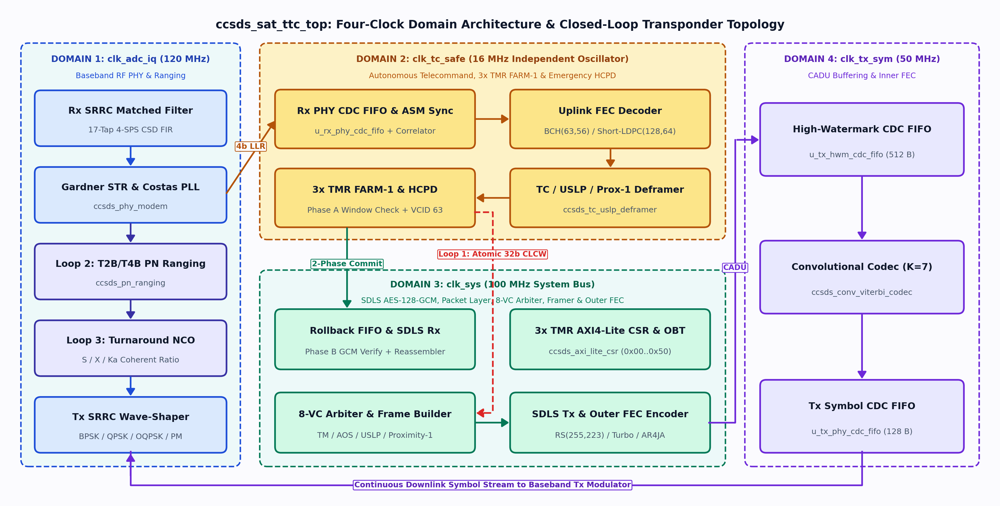
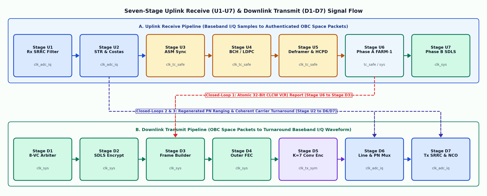
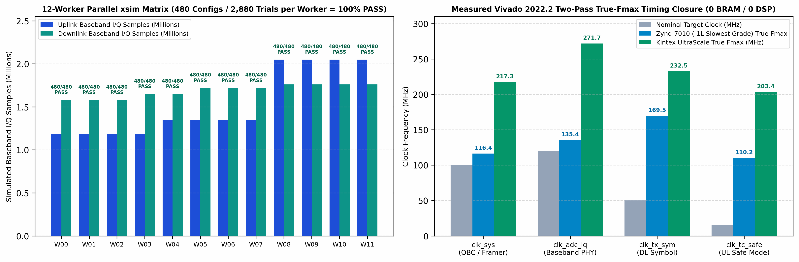

# CCSDS-SAT-TTC-IP (`v2.40.3`)
**Radiation-Mitigated Multi-Protocol Spacecraft Flight (`ROLE_MODE=0`), Hardware Ground EGSE (`ROLE_MODE=1`), and Universal Crosslink/BIST (`ROLE_MODE=2`) TT&C Transceiver IP Core**

[](rtl/ccsds_sat_ttc_top.sv)
[](docs/CCSDS_SAT_TTC_IP_Product_User_Guide.pdf)
[-047857.svg)](rtl/ccsds_sdls_engine.sv)
[](docs/ccsds_ttc_ip_engineering_book.pdf)
[](LICENSE)

`CCSDS-SAT-TTC-IP` (`ccsds_sat_ttc_top`) is a technology-independent, full-duplex digital baseband modem, Forward Error Correction (FEC) codec, multi-protocol data link framer/deframer, closed-loop COP-1/COP-P ARQ engine, wideband regenerative PN ranging correlator, and inline NIST SP 800-38D `AES-128-GCM` cryptographic security core written in synthesizable IEEE 1800-2017 SystemVerilog.

The core requires **0 Block RAMs (`0 RAMB36`)** and **0 DSP slices (`0 DSP48E1/E2`)**—eliminating hard-macro Single-Event Functional Interrupts (SEFIs) in radiation environments—and includes a complete **Vivado 2026.1.1 Block-Design & JTAG Bring-Up Suite** for the [Analog Devices ADRV9361-Z7035 SOM](https://www.analog.com/en/resources/evaluation-hardware-and-software/evaluation-boards-kits/adrv9361-z7035.html) (`xc7z035ifbg676-2L`) + [ADRV1CRR-BOB](https://www.analog.com/en/resources/evaluation-hardware-and-software/evaluation-boards-kits/adrv1crr-bob.html) breakout carrier.

---

## 1. Two-Volume Documentation Suite (`v2.40.3`)

| Volume | Document ID | Pages | Scope & Contents |
| :--- | :--- | :---: | :--- |
| **[Volume I — Product Guide & Hardware Integration Manual](docs/CCSDS_SAT_TTC_IP_Product_User_Guide.pdf)** | `PG-CCSDS-TTC-v2.40.3` | **23** | 30-module RTL inventory, compile-time generics, 4-clock timing closure, 59-port signal dictionary, `0x00..0x50` register map (`RESET_SCID_PROTO = 0x0130_0155`), ISO C11 HAL SDK (`sw/ccsds_ttc_hal.h`), S-Band transceiver wiring/BOM, and regression execution guide. |
| **[Volume II — Engineering Architecture & Mathematical Monograph](docs/ccsds_ttc_ip_engineering_book.pdf)** | `ENG-CCSDS-TTC-v2.40.3` | **18** | First-principles finite-field proofs ($GF(2^8)$ dual-basis, 16-bit unrolled CRC-16/32 companion matrix), Hsiao $(39,32)$ SECDED, Cycle-0 `FHP` induction proof, Two-Phase `FARM-1`/`SDLS` speculative commit proof, 17-tap 4-SPS CSD SRRC filter ($\alpha=0.35$), Friis noise-temperature cascade, and $600\,\text{km}$ LEO link budgets. |





---

## 2. Key Architectural Capabilities

* **Three Compile-Time Synthesizable Personas (`ROLE_MODE` sharing 78.6% of RTL):**
  * `ROLE_MODE = 0` (**Spacecraft Flight Transceiver**, 23 modules): Uplink `BCH(63,56)` SEC-DED & 4-phase `Short-LDPC(128,64)` Soft-OMS decoders, 3x TMR `FARM-1`, 3x TMR Emergency `HCPD` (`VCID=63`), and downlink dual-basis `RS(255,223)` ($I \in \{1..8\}$, implicit virtual fill $Q$) & 16-state RSC Turbo / AR4JA encoders.
  * `ROLE_MODE = 1` (**Hardware Ground EGSE Transceiver**, 22 modules): Ground `FOP-1` Go-Back-$N$ command initiator, `TC/CLTU` framer & `BCH(63,56)`/`LDPC(128,64)` encoder, $t=16$ Berlekamp-Massey/Chien/Forney `RS(255,223)` decoder, 64-state Radix-2 ACS soft Viterbi decoder, and ground `TM/AOS` deframer with live `CLCW` extraction.
  * `ROLE_MODE = 2` (**Universal Crosslink & On-Orbit BIST**, all 28 modules): Elaborates both flight and ground endpoints simultaneously.
* **Four Isolated Clock Domains & Zero-BRAM/Zero-DSP Footprint:**
  * `clk_adc_iq` (`120 MHz` Baseband RF PHY & PN Ranging), `clk_tc_safe` (`16 MHz` independent telecommand oscillator & emergency `HCPD`), `clk_sys` (`100 MHz` AXI4-Lite CSR, `SDLS`, & packet layer), and `clk_tx_sym` (`50 MHz` high-watermark CADU & inner $K=7$ convolutional codec).
  * All CDC FIFOs (`rtl/ccsds_cdc_fifo_ecc.sv`) infer **Distributed LUTRAMs (`RAM64M`)** protected by combinational **Hsiao $(39,32)$ SECDED** with speculative pointer rollback (`u_rx_commit_cdc_fifo`).
* **Zero-Trust Two-Phase `FARM-1` $\leftrightarrow$ `SDLS` Speculative Commit (`CCSDS 355.0-B-2`):**
  * Prevents unauthenticated spoofed frames from advancing $V(R)$ or triggering `FARM-1` Lockout, while enforcing domain-separated 96-bit `AES-128-GCM` IVs ($\text{IV}_{96} = \{\texttt{16'hCC5D}, \text{SCID}[9:0], \text{VCID}[5:0], \text{Seq}[31:0], \texttt{32'h5344\_4C53}\}$).

---

## 3. Hardware Bring-Up on Analog Devices `ADRV9361-Z7035` + `ADRV1CRR-BOB` (Vivado 2026.1.1)

The repository provides a staged hardware bring-up workflow targeting the **Xilinx Zynq-7000 `xc7z035ifbg676-2L`** on the Analog Devices `ADRV9361-Z7035` SOM mounted on the `ADRV1CRR-BOB` breakout carrier:

* **Stage 1 (In-Fabric Block-Design Baseband I/Q Loopback):** Instantiates both `ccsds_gnd_egse` (`ROLE_MODE=1` at `0x43C0_0000`) and `ccsds_sc_flight` (`ROLE_MODE=0` at `0x43C2_0000`) inside a Vivado 2026.1.1 Block Design (`system_stage1_loopback.bd`) using the Verilog-2001 wrapper `rtl/ccsds_sat_ttc_bd_wrapper.v`, cross-wiring their 16-bit baseband I/Q buses and connecting `axi_fifo_mm_s` packet streams (`0x43C1_0000` and `0x43C3_0000`) and `axi_gpio_straps` (`0x4120_0000`) to the Zynq PS7 ARM Cortex-A9 (`M_AXI_GP0`).
* **Stage 2 (Single-Board `axi_ad9361` Transceiver Loopback):** Connects `tx_i/q_dac_out[15:0]` and `rx_i/q_adc_in[15:0]` directly to the Analog Devices `axi_ad9361` LVDS interface core.
* **Stage 3 (Two-Board Over-the-Air / Coax Link):** Splits `ROLE_MODE = 1` (Ground EGSE on Board A) and `ROLE_MODE = 0` (Spacecraft Flight on Board B) across two `ADRV9361-Z7035` boards.

### Running Stage 1 in Vivado 2026.1.1 & XSDB

```powershell
# 1. Build the Stage 1 Vivado 2026.1.1 Project & Block Design:
vivado -mode batch -source scripts/create_z7035_stage1_bd_loopback.tcl

# 2. After generating the bitstream in Vivado, export the .xsa, .bit, and ps7_init.tcl:
#    (Run inside the Vivado Tcl Console):
source scripts/export_z7035_stage1_xsa.tcl

# 3. With the ADRV9361-Z7035 + BOB powered on and USB-JTAG connected, run the
#    1-command XSDB JTAG hardware loopback test (verifies CORE_ID_VER, T4B PN
#    ranging lock, Uplink "TOP_CMD1!!" CLTU/BCH loopback, Downlink "SAT_TLM_OK"
#    RS(255,223) loopback, and closed-loop CLCW V(R)=1 turnaround):
xsdb scripts/run_z7035_stage1_xsdb_test.tcl
```

For standalone bare-metal ARM Cortex-A9 execution in Vitis 2026.1.1, compile `sw/z7035_stage1_ps7_loopback_test.c` alongside `sw/ccsds_ttc_hal.c` against the exported `system_stage1_loopback_wrapper.xsa`.

---

## 4. RTL Simulation, Static Audit & 34,560-Trial RF Matrix Verification

### 4.1 Running Individual Verification Stages (`Stages 2..12`) in Vivado `xsim` or `Verilator`

```powershell
# Windows PowerShell / CMD with AMD Vivado xsim:
.\scripts\run_eda_sim.bat xsim 8    # Stage 8 : 5-Protocol Loopback + Real VCD Waveform Matcher
.\scripts\run_eda_sim.bat xsim 9    # Stage 9 : External spacepackets-py & PyCA cryptography NIST Vectors
.\scripts\run_eda_sim.bat xsim 10   # Stage 10: 5-Matrix Impaired-Channel Link-Closure Stress Suite
.\scripts\run_eda_sim.bat xsim 11   # Stage 11: Top-to-Top (ROLE=1 <-> ROLE=0) RF Baseband Link Testbench
.\scripts\run_eda_sim.bat xsim 12   # Stage 12: 550 km LEO Orbital Pass S-Curve Doppler & Deep-Fade Replay
```

```bash
# Linux / WSL using Makefile (supports SIM=xsim | verilator | questa | icarus):
make audit                          # Gate 1: Static IEEE 1800-2017 AST & Hierarchy Audit (41 .sv files)
make lint                           # Gate 2: Verilator Full-Hierarchy Synthesizable RTL Lint
make hal-test                       # Gate 3: Bare-Metal ISO C11 HAL SDK Unit Test (sw/test_ccsds_ttc_hal.c)
make sim SIM=verilator STAGE=11     # Gate 4: Cycle-Accurate SystemVerilog Simulation
```

### 4.2 Running the 12-Worker Parallel 34,560-Trial Full-Chip RF Matrix (`Stage 11`)

```powershell
# Launch 12 parallel Vivado xsim workers across all 5,760 valid CCSDS configurations x 6 channel profiles:
.\scripts\run_stage11_matrix_parallel.bat 12 6 progressive
```



| Verification Suite | Scope & Impairment Coverage | Measured Result |
| :--- | :--- | :--- |
| **`Stages 2–9` Foundational & Golden Vector Suites** | CRC-16/32, $GF(2^8)$ dual-basis, Hsiao SECDED, all 5 framers/deframers, `BCH`/`LDPC`/`RS`/`Viterbi`, 3x TMR `FARM-1`/`HCPD`, and [`spacepackets-py`](https://github.com/us-irs/spacepackets-py) + [`cryptography`](https://cryptography.io/) NIST `AES-128-CTR/GCM` vectors | **PASS (`100%` bit-exact match)** |
| **`Stage 10` Open-Loop Waterfall Sweep** | 23-point $E_b/N_0$ sweep ($0.0\text{–}11.0\,\text{dB}$) across all uplink (`BCH`, `LDPC`) and downlink (`Conv`, `RS`, `Concat`, `AR4JA`, `Turbo`) codecs | **PASS (Matches CCSDS curves within $\pm 0.3\,\text{dB}$)** |
| **`Stage 11` 34,560-Trial Full-Chip RF Matrix** | 5,760 valid CCSDS configurations $\times$ 6 channel profiles (`P0..P5`) across `39,306,240` baseband I/Q samples with `23,040` injected pre-FEC channel bit errors at rated SNR | **PASS (`34,560 / 34,560` trials, `0` post-FEC errors)** |
| **`Stage 12` LEO Orbital Pass Loopback (`CFG-1..6`)** | 28 Gardner timing phases ($\tau \in \{0..3\}$), $\pm 50.8\,\text{kHz}$ S-Band / $\pm 178.1\,\text{kHz}$ X-Band S-curve Doppler, $1{,}009{,}470$-chip PN ranging, mid-pass $-16.5\,\text{dB}$ Rician deep fade with automatic COP-1 Go-Back-$N$ recovery, and `VCID=63` `HCPD` reset | **PASS (`0` lost or duplicate packets)** |

---

## 5. Synthesis Resource Utilization & Two-Pass True-$F_{\max}$ Timing Closure

All memory buffers map to **Distributed LUTRAMs (`RAM64M`)** with Hsiao $(39,32)$ SECDED scrubbing, and all matched filters use multiplier-free Canonical Signed-Digit (CSD) shift-add trees:

| Synthesis Profile (`ROLE_MODE = 0`) | Total LUTs (Logic + LUTRAM) | Slice Flip-Flops | BRAM / DSP | Zynq-7020 (`53.2k` LUT6) | Zynq-7035 (`171.9k` LUT6) | Kintex UltraScale (`XQRKU060`) |
| :--- | :---: | :---: | :---: | :---: | :---: | :---: |
| **Full Flight (`SDLS=1, LDPC=1`)** | **28,861** (`27.6k + 1.2k`) | **13,864** | **0 / 0** | `54.25%` | **`16.79%`** | `8.70%` |
| **BCH + GCM (`SDLS=1, LDPC=0`)** | **16,251** (`15.0k + 1.2k`) | **12,732** | **0 / 0** | `30.55%` | **`9.45%`** | `4.90%` |
| **Compact (`SDLS=0, LDPC=0`)** | **8,332** (`7.1k + 1.2k`) | **7,161** | **0 / 0** | `15.66%` | **`4.85%`** | `2.51%` |

| Clock Domain | Nominal Target | Slowest-Grade Zynq-7010 (`-1L`) True $F_{\max}$ | Kintex UltraScale (`XQRKU060`) True $F_{\max}$ | Logic Levels | Limiting Physical Critical Path |
| :--- | :---: | :---: | :---: | :---: | :--- |
| **`clk_sys`** | `100.0 MHz` (`10.0 ns`) | **`116.40 MHz`** (`8.59 ns`) | **`217.34 MHz`** (`4.60 ns`) | `7` | `u_rx_commit_cdc_fifo/rd_ptr_q[0] -> u_csr/cnt_uncorr_err_q[0]` |
| **`clk_adc_iq`** | `120.0 MHz` (`8.33 ns`) | **`135.41 MHz`** (`7.39 ns`) | **`271.74 MHz`** (`3.68 ns`) | `9` | `u_phy_modem/rx_phase_q16[10] -> u_phy_modem/i_derot_q[13]` |
| **`clk_tx_sym`** | `50.0 MHz` (`20.0 ns`) | **`169.46 MHz`** (`5.90 ns`) | **`232.50 MHz`** (`4.30 ns`) | `9` | `u_tx_hwm_cdc_fifo/wr_sync2[1] -> u_tx_hwm_cdc_fifo/rd_gray[6]` |
| **`clk_tc_safe`** | `16.0 MHz` (`62.5 ns`) | **`110.22 MHz`** (`9.07 ns`) | **`203.38 MHz`** (`4.92 ns`) | `11` | `u_ul_deframer/cur_tc_hdr[vcid] -> u_farm1/clcw_scheduled_out` |

---

## 6. Repository Directory Structure

```text
ccsds_sat_ttc_ip/
├── rtl/                                      # 28 Synthesizable SV Modules + 2 Channel Models + .v BD Wrapper
│   ├── ccsds_sat_ttc_top.sv                  # Top-level parameterized transceiver (ROLE_MODE = 0, 1, 2)
│   ├── ccsds_sat_ttc_bd_wrapper.v            # Verilog-2001 Vivado IP Integrator Module Reference wrapper
│   └── ...
├── sw/                                       # Zero-Dependency Bare-Metal ISO C11 HAL SDK & PS7 Tests
│   ├── ccsds_ttc_hal.h / ccsds_ttc_hal.c     # Register-accurate HAL driver & Blue Book config validator
│   ├── test_ccsds_ttc_hal.c                  # Host/CI unit test suite for the C11 HAL SDK
│   └── z7035_stage1_ps7_loopback_test.c      # Bare-metal Zynq-7035 ARM Cortex-A9 loopback test
├── scripts/                                  # Simulation, Synthesis, Vivado 2026.1.1 BD & XSDB JTAG Scripts
│   ├── create_z7035_stage1_bd_loopback.tcl   # Stage 1 Vivado 2026.1.1 Block Design generator (xc7z035ifbg676-2L)
│   ├── export_z7035_stage1_xsa.tcl           # Exports .xsa, .bit, and ps7_init.tcl from Vivado
│   ├── run_z7035_stage1_xsdb_test.tcl        # 1-command XSDB JTAG hardware loopback verification script
│   ├── run_stage11_matrix_parallel.py        # 12-worker parallel 34,560-trial full-chip RF matrix runner
│   └── sync_from_gdrive.py / .bat            # Local Google Drive synchronization utility
├── docs/                                     # Two-Volume Publication Suite (LaTeX .tex, PDF & Figures)
│   ├── CCSDS_SAT_TTC_IP_Product_User_Guide.pdf
│   ├── ccsds_ttc_ip_engineering_book.pdf
│   └── figures/                              # Vector (.pdf) & Raster (.png) architectural block diagrams
├── constraints/                              # Timing & Board XDC Constraints
│   ├── ccsds_kintex_ultrascale.xdc
│   └── adrv9361_z7035_bob_stage1.xdc
├── tb/                                       # 11 Self-Checking SystemVerilog Testbenches (Stages 2..12)
└── reports/                                  # Measured STA, Utilization, Waterfall & Matrix JSON/CSV/PNG Reports
```
