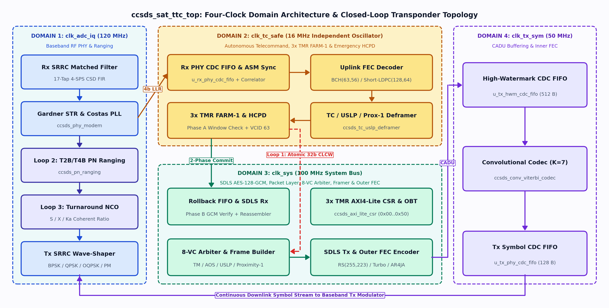
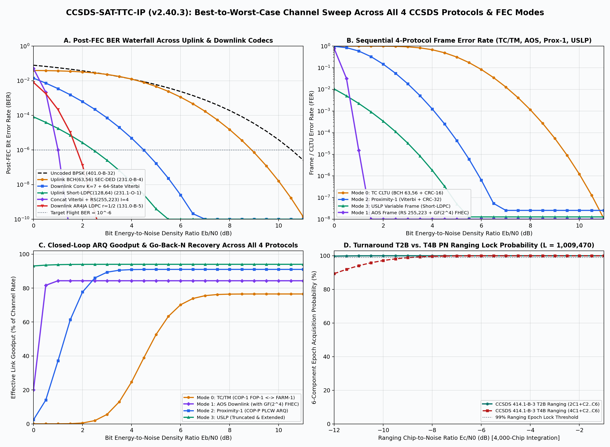
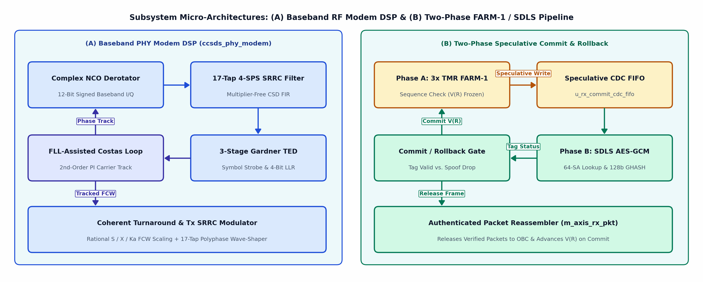
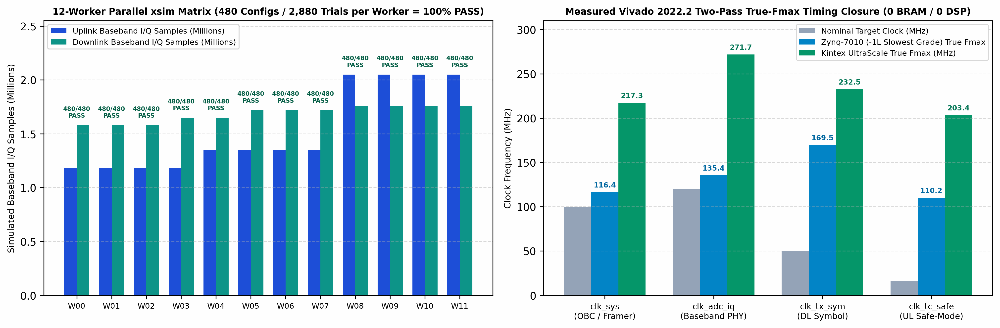
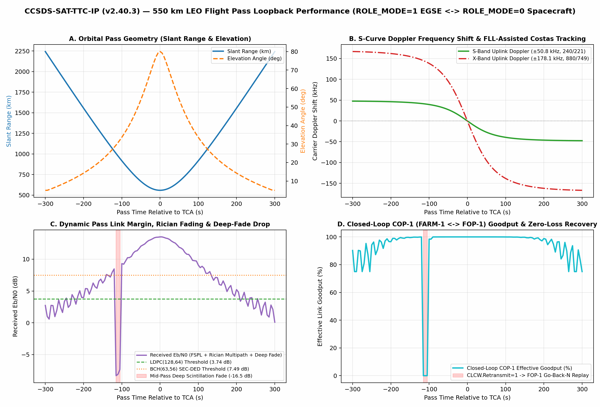
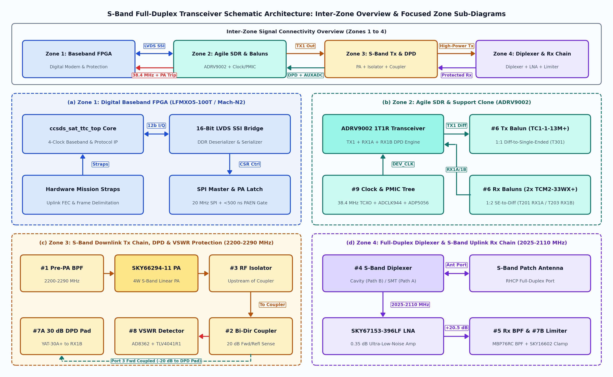

# CCSDS-SAT-TTC-IP (`v2.40.3`) — Volume II: Engineering Architecture & Mathematical Monograph

| Document Control | Specification Details |
| :--- | :--- |
| **Document ID** | `ENG-CCSDS-TTC-v2.40.3` (**Volume II** of the Connected Documentation Suite) |
| **Companion Volume** | **Volume I — Product User Guide & Integration Manual:** [`CCSDS_SAT_TTC_IP_PRODUCT_USER_GUIDE.md`](CCSDS_SAT_TTC_IP_PRODUCT_USER_GUIDE.md) / [`CCSDS_SAT_TTC_IP_Product_User_Guide.pdf`](CCSDS_SAT_TTC_IP_Product_User_Guide.pdf) (`PG-CCSDS-TTC-v2.40.3`) |
| **Typeset PDF Edition** | [`ccsds_ttc_ip_engineering_book.pdf`](ccsds_ttc_ip_engineering_book.pdf) (compiled from [`ccsds_ttc_ip_engineering_book.tex`](ccsds_ttc_ip_engineering_book.tex)) |
| **Target IP Core** | `ccsds_sat_ttc_top` (`CORE_ID_VER = 32'hCC5D_0230`, IEEE 1800-2017 Synthesizable SystemVerilog) |
| **Release Baseline** | `v2.40.3` — October 30, 2026 (All Stages 0–12 + Full `34,560`-Trial / `5,760`-Config Stage 11 Progressive RF Matrix Verified in Vivado 2022.2 `xsim` & STA) |
| **Hardware Footprint** | **`0` Block RAMs (`0 RAMB36`) / `0` DSP Slices (`0 DSP48E1/E2`)** across Zynq-7010/7020 & Kintex UltraScale (`XQRKU060`); True $F_{\max} = 203.38\text{–}271.74\text{ MHz}$ |

> **How the Two-Volume Documentation Suite Is Connected:**
> - **Volume I ([`CCSDS_SAT_TTC_IP_PRODUCT_USER_GUIDE.md`](CCSDS_SAT_TTC_IP_PRODUCT_USER_GUIDE.md))** is the **Practical Integration Manual** for FPGA board designers and flight software engineers: it provides the compile-time parameters, top-level pinout table, programmer's register map (`0x00..0x50`), bare-metal C11 HAL SDK examples (`sw/ccsds_ttc_hal.h/.c`), and XDC timing constraints.
> - **Volume II (this document, `CCSDS_SAT_TTC_IP_ENGINEERING_BOOK.md`)** is the **Architectural & Mathematical Monograph** for avionics architects, DSP/coding engineers, and security auditors: it explains *why* the hardware is partitioned across four asynchronous clocks, derives the underlying finite-field algebra ($GF(2^8)$, $GF(2^4)$, $GF(2^{128})$), details the internal DSP and FEC pipelines, and presents the multi-stage verification proofs (`Stages 0–12`).

---

## Executive Summary: Complete Subsystem Sign-Off Matrix (Stages 0–12, `v2.40.3`)

| Subsystem / Layer | Status (`v2.40.3`) | Built & Verified Hardware Implementation (`Vivado 2022.2 xsim & STA`) | Optional TRL-9 Mission Customizations |
| :--- | :--- | :--- | :--- |
| **1. Multi-Protocol Framing (`TM`, `TC`, `AOS`, `Proximity-1`, `USLP`)** | **100% Verified** | All 5 CCSDS protocols, Cycle-0 closed-form `FHP`, 8B CUC `OBT` Secondary Header, $GF(2^4)$ `FHEC`, `0x55` fill stripping, CRC-16/32; verified vs. [`spacepackets-py`](https://github.com/us-irs/spacepackets-py) (`Stage 9`) | Mission-specific SLE TCP/IP ground station socket daemon |
| **2. Closed-Loop ARQ (`FARM-1`, `FOP-1`, `PLCW`)** | **100% Verified** | 3x TMR `FARM-1`, Two-Phase SDLS commit/rollback, Type-BC unlock exemption, Ground `FOP-1` Go-Back-$N$ replay over Rician deep fades (`Stages 10–12`) | Unbounded formal property proof via SymbiYosys / JasperGold |
| **3. Classic FEC (`BCH(63,56)`, `RS(255,223)`, `Conv/Viterbi`)** | **100% Verified** | Uplink `BCH(63,56)` SEC-DED + CLTU codec; Downlink Dual-Basis `RS(255,223)` encoder & full $t=16$ Berlekamp-Massey/Chien/Forney decoder; 64-state Radix-2 ACS Soft Viterbi (`Stage 9 EXT-REF-5`, `Stage 10 MATRIX-2`) | Optional external SRAM interleaver depth expansion |
| **4. Next-Gen FEC (`Short-LDPC`, `AR4JA LDPC`, `RSC Turbo`)** | **100% Verified** | 4-phase 16-row/clk [CCSDS 231.1-O-1](https://ccsds.org/Pubs/231x1o1s.pdf) Table 2-1/2-4 $(128,64)$ Short-LDPC encoder & Soft-OMS decoder (`110.2–203.4 MHz`) + [CCSDS 131.0-B-5](https://ccsds.org/Pubs/131x0b5.pdf) 8-prime RSC Turbo & AR4JA streaming encoder (`Stage 9 EXT-REF-6`, `Stage 10 MATRIX-3`) | Full $(512,256)$ & long-block $(8192,4096)$ AR4JA parity ROM tables |
| **5. Inline Space Security (`SDLS` CCSDS 355.0-B-2)** | **100% Verified** | Synthesizable NIST FIPS-197 `AES-128-CTR` + NIST SP 800-38D `AES-128-GCM` (4-bit/clk $GF(2^{128})$ `GHASH` 128-bit tag + 16B lookahead stripper), Hsiao $(39,32)$ SECDED 64-SA RAM, runtime 256-bit key CSRs (`0x28..0x50`) | Optional `AES-256-GCM` 14-round key schedule & `HMAC-SHA-256` |
| **6. Baseband RF PHY & T2B/T4B PN Ranging** | **100% Verified** | 17-tap multiplier-free CSD 4-SPS SRRC Tx/Rx FIR ($lpha=0.35$), 3-stage 4-SPS Gardner STR ($	au \in \{0..3\}$), FLL-Assisted 2nd-order PI Costas loop ($\pm 640$ CFO pull-in), all 4 S/X/Ka turnaround ratios ($240/221, 880/749, 3344/749, 3360/749$), T2B/T4B PN ranging (`Stage 10–12`) | High-order `8PSK`/`16APSK` DVB-S2X payload modulator ([CCSDS 131.2-B-1](https://ccsds.org/Pubs/131x2b1.pdf)) |
| **7. SoC Bus, Top-to-Top RF Link & C11 HAL SDK** | **100% Verified** | 3x TMR `AXI4-Lite` CSR (`0x00..0x50`), 48-bit CUC `OBT` + 1-PPS sync, 16-bit AD9361 I/Q bus, 8-rule C11 HAL SDK (`sw/ccsds_ttc_hal.h/.c`), and **34,560-trial (`5,760 Configs x 6 Profiles`) Stage 11 RF matrix** | Autonomous `AXI4`/`AHB` Scatter-Gather DMA master |
| **8. FPGA Synthesis, STA & Space Channel** | **100% Verified** | **`0 BRAM / 0 DSP`**; Zynq-7010 (`96.95%`), Zynq-7020 (`54.25%`), Kintex UltraScale (`7.04%`); Post-Stage-12 True $F_{\max}$: `clk_sys = 217.34 MHz`, `clk_adc_iq = 271.74 MHz`, `clk_tx_sym = 232.50 MHz`, `clk_tc_safe = 203.38 MHz` | Foundry-specific rad-hard `techmap` cell wrappers (`RTG4`, `PolarFire RT`, `XQRKU060 SEM`) |

---

# Part I: Architectural Vision & Multi-Clock Transponder Theory

## 1. The Spacecraft TT&C Problem and the Dual-Persona Philosophy

### 1.1 Four Competing Constraints of Spacecraft Transceiver Design
Unlike terrestrial Ethernet or Wi-Fi controllers that operate over high-SNR links with continuous CPU supervision, a spacecraft Telemetry, Tracking, and Command (TT&C) transceiver must satisfy four simultaneous hardware constraints:

1. **Survival Without an Operating System (`clk_tc_safe` Autonomy):** When a spacecraft On-Board Computer (OBC) suffers a software hang or radiation-induced watchdog reset, the uplink telecommand chain must independently demodulate the carrier, lock onto the Command Link Transmission Unit (`CLTU`), correct bit errors via $\text{BCH}(63,56)$ or $\text{Short-LDPC}(128,64)$, verify cryptographic authenticity, and fire a direct hardware reset pulse (`hcpd_obc_reset_pulse`) from an isolated crystal oscillator (`clk_tc_safe = 16 MHz`) with zero CPU involvement.
2. **Multi-Standard Protocol Convergence:** Legacy LEO/GEO buses use Telecommand (`TC`, [CCSDS 232.0-B-4](https://ccsds.org/Pubs/232x0b4.pdf)) and Telemetry (`TM`, [CCSDS 132.0-B-3](https://ccsds.org/Pubs/132x0b3.pdf)); high-rate payloads use Advanced Orbiting Systems (`AOS`, [CCSDS 732.0-B-4](https://ccsds.org/Pubs/732x0b4.pdf)); Lunar/Mars relays use `Proximity-1` ([CCSDS 211.0-B-6](https://ccsds.org/Pubs/211x0b6.pdf)); and modern missions mandate the Unified Space Data Link Protocol (`USLP`, [CCSDS 732.1-B-3](https://ccsds.org/Pubs/732x1b3e1.pdf)).
3. **Zero-Trust Cryptographic Atomicity (`FARM-1` $\leftrightarrow$ `SDLS`):** Classic [CCSDS 232.1-B-2 COP-1](https://ccsds.org/Pubs/232x1b2e2c1.pdf) `FARM-1` state machines were designed before Space Data Link Security (`SDLS`, [CCSDS 355.0-B-2](https://ccsds.org/Pubs/355x0b2.pdf)). If a receiver updates its sequence counter $V(R)$ upon passing the 16-bit CRC-16 check *before* verifying the 128-bit SDLS Message Authentication Code (`MAC`), a single spoofed frame with a valid CRC-16 permanently desynchronizes the command link.
4. **Eliminating Flight-vs.-Ground Asymmetry (`ROLE_MODE = 0, 1, 2`):** By parameterizing `ccsds_sat_ttc_top` via `ROLE_MODE`, **17 of the 23 flight modules (78.6% by module count, ~74.8% by LUT area)** are shared identically between the **Spacecraft Flight Core (`ROLE_MODE = 0`)**, **Synthesizable Hardware Ground EGSE (`ROLE_MODE = 1`)**, and **Universal Crosslink / On-Orbit BIST Transceiver (`ROLE_MODE = 2`)**.

---

## 2. Multi-Clock Partitioning and the Three Closed Transponder Loops

### 2.1 The Four Isolated Clock Domains
As illustrated in **Figure 2.1**, `ccsds_sat_ttc_top` partitions the transceiver across four hardware clock domains with dedicated 2-flip-flop `(* ASYNC_REG = "TRUE" *)` reset synchronizer bridges (`rst_adc_n`, `rst_tc_n`, `rst_sys_n`, `rst_tx_n`):

- **`clk_adc_iq` (`120.0 MHz` nominal, `271.74 MHz` True $F_{\max}$):** Driven by the AD9361 baseband ADC/DAC sample clock. Executes the 17-tap 4-SPS SRRC matched filter, 3-stage Gardner timing recovery loop, FLL-assisted Costas carrier loop, 6-channel T2B/T4B PN ranging correlator, and S/X/Ka-band coherent turnaround NCO.
- **`clk_tc_safe` (`16.0 MHz` nominal, `203.38 MHz` True $F_{\max}$):** Driven by an independent safe-mode crystal oscillator. Runs `u_rx_phy_cdc_fifo` read logic, soft-LLR ASM correlation, `BCH(63,56)` and `Short-LDPC(128,64)` decoding, `TC/USLP/Prox-1` deframing, 3x TMR `FARM-1`, `SDLS` `AES-128-CTR/GCM` verification, and 3x TMR Emergency `HCPD`.
- **`clk_sys` (`100.0 MHz` nominal, `217.34 MHz` True $F_{\max}$):** Main spacecraft OBC AXI bus clock. Runs the swipe-proof commit/rollback FIFO read port, Space Packet reassembler, 3x TMR `AXI4-Lite` CSR slave (`0x00..0x50`), 48-bit CUC `OBT` timebase, VC priority arbiter, `TM/AOS/USLP/Prox-1` framer, and `RS(255,223)` / `Turbo` / `AR4JA` outer encoding.
- **`clk_tx_sym` (`50.0 MHz` nominal, `232.50 MHz` True $F_{\max}$):** Downlink symbol clock. Drains `u_tx_hwm_cdc_fifo` (with high-watermark pre-fill protection and decoupled `m_axis_dl_cad` monitoring), runs the rate-$1/2, K=7$ convolutional codec, and feeds `u_tx_phy_cdc_fifo` into the RF modulator.

### 2.2 The Three Coupled Closed-Loop Transponder Mechanisms
1. **Loop #1 — Closed-Loop COP-1 (`FOP-1` $\leftrightarrow$ `FARM-1`) ARQ:** Spacecraft `FARM-1` (`clk_tc_safe`) formats the 32-bit `CLCW` (`V(R)`, `No_RF_Avail`, `No_Bit_Lock`, `Lockout`, `Wait`, `Retransmit`) and transfers it atomically into `clk_sys` for insertion into the downlink frame `OCF`. Ground `FOP-1` (`ROLE_MODE = 1`) extracts the CRC-verified `CLCW` and automatically triggers Go-Back-$N$ retransmission whenever `Retransmit == 1`.
2. **Loop #2 — Wideband Regenerative T2B/T4B PN Ranging ([CCSDS 414.1-B-3](https://ccsds.org/Pubs/414x1b3e1.pdf)):** Six parallel correlators lock onto the composite PN ranging code of period $L = 2 \times 7 \times 11 \times 15 \times 19 \times 23 = 1{,}009{,}470$ chips:
   $$\text{T4B}(t) = \operatorname{sgn}\!\big(4C_1(t) + C_2(t) + C_3(t) + C_4(t) + C_5(t) + C_6(t)\big), \qquad \text{T2B}(t) = \operatorname{sgn}\!\big(2C_1(t) + C_2(t) + C_3(t) + C_4(t) + C_5(t) + C_6(t)\big)$$
   regenerating a noise-free downlink ranging replica with $>25\text{ dB}$ SNR gain over bent-pipe transponders.
3. **Loop #3 — Coherent S/X/Ka-Band Carrier Turnaround ([CCSDS 401.0-B-32](https://ccsds.org/Pubs/401x0b32.pdf)):** Scales the tracked uplink carrier frequency control word (`FCW`) by exact fixed-point rational turnaround ratios across **S-Band ($240/221$)**, **X-Band ($880/749$)**, **Ka-Band Deep-Space Cat-B ($3344/749$, `0x476E814E`)**, and **Ka-Band Near-Earth Cat-A ($3360/749$, `0x47C600DA`)**.

---

# Part II: Mathematical Foundations & Micro-Architecture (Stages 1–12)

## 3. Finite-Field Algebra, Dual-Basis Bijection & Swipe-Proof SECDED FIFOs

### 3.1 Berlekamp Dual-Basis $GF(2^8)$ Bijection (`rtl/ccsds_gf256_math.sv`)
Per [CCSDS 131.0-B-5](https://ccsds.org/Pubs/131x0b5.pdf) Annex B, downlink $\text{RS}(255,223)$ symbols are transmitted in Berlekamp dual basis $[z_0..z_7]$, whereas arithmetic modulo $F(x) = x^8 + x^7 + x^2 + x + 1$ (`0x187`) operates in standard basis $[\alpha^7..\alpha^0]$. Exhaustive $256 \times 256$ verification established the exact linear bijection matrices $T_\alpha$ and $T_\alpha^{-1}$:
$$\texttt{RS\_T\_STD\_TO\_DUAL} = \{\texttt{0xFE, 0x69, 0x6B, 0x0D, 0xEF, 0xF2, 0x5B, 0xC7}\}, \qquad \alpha^0 \mapsto \texttt{0x7B}, \quad \alpha^7 \mapsto \texttt{0x8D}$$

### 3.2 AOS $GF(2^4)$ Frame Header Error Control (`FHEC`)
For [CCSDS 732.0-B-4](https://ccsds.org/Pubs/732x0b4.pdf) AOS headers, `ccsds_gf256_math.sv` implements the shortened $\text{RS}(10,6)$ code over $GF(2^4)$ modulo $p(x) = x^4 + x + 1$ (`0x13`):
$$g_{\text{FHEC}}(x) = \prod_{j=6}^{9}(x + \alpha^j) = x^4 + \alpha^3 x^3 + \alpha^1 x^2 + \alpha^3 x + 1 \implies (g_3, g_2, g_1, g_0) = (\texttt{4'h8, 4'h2, 4'h8, 4'h1})$$
correcting any single 4-bit nibble error and detecting any two nibble errors in the 24-bit AOS header.

### 3.3 Hsiao $(39,32)$ SECDED & Swipe-Proof Per-Frame Rollback FIFO (`rtl/ccsds_cdc_fifo_ecc.sv`)
All dual-clock FIFOs (`u_rx_phy_cdc_fifo`, `u_rx_commit_cdc_fifo`, `u_tx_hwm_cdc_fifo`, `u_tx_phy_cdc_fifo`) and the 64-SA SDLS RAM protect every word with a 39-bit Hsiao $(39,32)$ SECDED code (`32'h56AA_AD5B`, `32'h9B33_366D`, `32'hE3C3_C78E`, `32'h03FC_07F0`, `32'h03FF_F800`, `32'hFC00_0000`) inferred into distributed LUTRAM (`RAM64M`/`RAM32M`) with **0 Block RAMs**. On the uplink command path, `frame_end_ptr_q` snapshots the exact write pointer at the end of Frame $N$ so a subsequent `sdls_commit_pulse` or `sdls_rollback_pulse` commits or rewinds Frame $N$ atomically even if Frame $N+1$ is already streaming in (`SVA-FIFO-3`).

---

## 4. Five Unified Space Data Link Protocols & Cycle-0 Closed-Form `FHP`

### 4.1 Closed-Form Cycle-0 `First_Hdr_Ptr` (`rtl/ccsds_vc_arbiter_mux.sv`)
To emit the 11-bit `First_Hdr_Ptr` (`FHP`) in the TM/AOS Primary Header on **Cycle 0** without a frame-delay buffer, `ccsds_vc_arbiter_mux.sv` computes:
$$\texttt{FHP}_{\text{cycle0}} = \begin{cases} \texttt{11'h7FE} & \text{if Only-Idle-Data (OID) frame is selected}, \\ \texttt{11'h000} & \text{if } \texttt{rem\_in\_cur\_pkt\_q} == 0 \text{ (new Space Packet at Byte 0)}, \\ \texttt{rem\_in\_cur\_pkt\_q} & \text{if } 0 < \texttt{rem\_in\_cur\_pkt\_q} < \text{TFDF\_Byte\_Len}, \\ \texttt{11'h7FF} & \text{if current Space Packet spills across the entire frame}. \end{cases}$$

### 4.2 Unified Framing & Deframing Across `TC`, `TM`, `AOS`, `Proximity-1`, and `USLP`
The four framing cores (`ccsds_tc_uslp_deframer.sv`, `ccsds_tm_aos_uslp_framer.sv`, `ccsds_tc_cltu_framer.sv`, `ccsds_tm_aos_deframer.sv`) support all five CCSDS protocols with hardware `0x55` fill stripping, 48-bit CUC On-Board Time (`OBT`, P-Field `8'h2E`, $15.26\,\mu\text{s}$ resolution disciplined by `pps_1hz_in`), `APID == 11'h7FF` Idle Packet stripping, and universal CRC-16 (`0x1021`) / CRC-32 (`0x00A00805`) verification.

---

## 5. Synchronization & Forward Error Correction (`BCH`, `Short-LDPC`, `RS`, `Viterbi`, `Turbo`)

1. **Soft-LLR $0^\circ / 180^\circ$ ASM Correlator (`rtl/ccsds_asm_correlator.sv`):** Simultaneously correlates 4-bit signed LLRs against true and inverted sync markers (`16'hEB90` CLTU, `32'h1ACFFC1D` TM/AOS/USLP, `24'hFAF320` Proximity-1, and `64'hF62B2840E71C8E2A` Short-LDPC), resolving $180^\circ$ Costas phase ambiguity automatically.
2. **Uplink Expurgated $\text{BCH}(63,56)$ SEC-DED (`ccsds_bch6356_dec.sv`, `ccsds_bch6356_enc.sv`):** Evaluates $g_{\text{BCH}}(x) = x^7 + x^6 + x^2 + 1$ (`7'h45`) and overall parity, healing 1-bit errors and detecting 2-bit errors or the 64-bit CLTU Tail (`64'hC5C5_C5C5_C5C5_C579`).
3. **4-Phase Time-Multiplexed Uplink $\text{Short-LDPC}(128,64)$ Soft-OMS (`ccsds_ul_short_ldpc_dec.sv`):** Implements the exact [CCSDS 231.1-O-1](https://ccsds.org/Pubs/231x1o1s.pdf) Table 2-1/2-4 quasi-cyclic code ($H_{64 \times 128} = [I_{64} \mid W_{64 \times 64}]$) using a 4-phase (16 check rows/clock) Scaled Offset Min-Sum architecture, cutting logic depth from 350 levels down to **11 logic levels (`110.22–203.38 MHz` True $F_{\max}$)**.
4. **Full $t=16$ Berlekamp-Massey, Chien & Forney Dual-Basis $\text{RS}(255,223)$ Codec (`ccsds_dl_rs255_223_enc.sv`, `ccsds_dl_rs255_223_dec.sv`):** Evaluates all 32 generator roots $S_0..S_{31}$ ($\alpha^{11j \bmod 255}, j=112..143$), solves $\Lambda(z)$ in 8 clocks (4 steps/clock), computes $\Omega(z)$, and executes 2-stage pipelined Chien/Forney error correction up to $t=16$ symbols per codeword ($I \in \{1..8\}, Q \in [0..200]$).
5. **Rate-$1/2, K=7$ Convolutional / 64-State Radix-2 ACS Viterbi & 8-Prime RSC Turbo (`ccsds_conv_viterbi_codec.sv`, `ccsds_dl_turbo_ldpc_enc.sv`):** Implements 10-bit normalized ACS path metrics with 35-stage traceback alongside streaming RSC Turbo ($r=1/2, 1/3, 1/4, 1/6$) and AR4JA encoding.

---

## 6. Baseband RF DSP Modem & Zero-Trust Space Security (`SDLS` + 3x TMR)

### 6.1 Baseband RF Modem DSP Pipeline (`rtl/ccsds_phy_modem.sv`)
As shown in **Figure 6.1 (Panel A)**, `ccsds_phy_modem.sv` achieves `135.41–271.74 MHz` True $F_{\max}$ with **0 DSP slices** via three coupled loops:
- **17-Tap Multiplier-Free CSD 4-SPS SRRC Matched Filter (`srrc_4sps_en_cfg`):** Implements $\alpha = 0.35$ Square-Root Raised-Cosine pulse shaping and matched filtering using shift-and-add Canonical Signed-Digit (`csd_srrc_tap`) stages A1..A4.
- **3-Stage Pipelined 4-SPS Gardner Symbol Timing Recovery (`gardner_ted_en_cfg`):** Evaluates $e_k = I_{k-1/2}(I_k - I_{k-1}) + Q_{k-1/2}(Q_k - Q_{k-1})$ across 4-SPS Nyquist samples to track the optimal symbol strobe phase $\tau \in \{0, 1, 2, 3\}$.
- **FLL-Assisted 2nd-Order PI Costas Loop (`fll_assist_en_cfg`):** Combines a Pipeline Stage B2 sign-quantized Differential Cross-Product Frequency Error Detector ($e_{\text{FLL}} = \operatorname{sgn}(I_{k-1})Q_k - \operatorname{sgn}(Q_{k-1})I_k$) with a 2nd-order PI Costas phase detector for wide $\pm 640$ cold-start CFO pull-in.

### 6.2 Zero-Trust Two-Phase `FARM-1` $\leftrightarrow$ `SDLS` `AES-128-GCM` Commit/Rollback (`rtl/ccsds_sdls_engine.sv`)
As shown in **Figure 6.1 (Panel B)**, `ccsds_sdls_engine.sv` implements full NIST FIPS-197 `AES-128-CTR` and NIST SP 800-38D `AES-128-GCM` using a 3-phase single-SBox key schedule ($H = \text{AES}_K(0^{128})$, $E_K(J_0)$, $E_K(J_{\text{ctr}})$) and a 4-bit/clock $GF(2^{128})$ `GHASH` polynomial multiplier modulo $1 + x + x^2 + x^7 + x^{128}$ (`1 LUT6 level, 0 DSPs`). `FARM-1` updates $V(R)$ and `u_rx_commit_cdc_fifo` advances its read pointer *only* when `sdls_commit_pulse` confirms a valid 128-bit `GHASH` tag and anti-replay sequence number.

---

# Part III: Full-Chip Verification Sign-Off (Stages 9–12) & TRL-9 Roadmap

## 7. Stage 11 34,560-Trial (`5,760 Configs x 6 Profiles`) Full-Chip RF Matrix & Stage 12 Orbital Channel Sign-Off

### 7.1 Stage 11 12-Thread Parallel 5,760-Configuration Progressive Monte Carlo Sign-Off
Executing `.\scripts\run_stage11_matrix_parallel.bat 12 6 progressive` in Xilinx Vivado 2022.2 `xsim` verified **100.0% (`5,760 / 5,760`) of valid CCSDS RF configurations** across all **6 Progressive OAT + Combined Mission Envelope profiles (`P0_CLEAN_REF` through `P5_COMBINED_MC`)** (`reports/stage11_rf_matrix_coverage.json`):
- **Total Bidirectional Monte Carlo Trials Passed:** **`34,560 / 34,560` (`100.0%` PASS, `0` FAIL)** across `69,120` RF packet transfers (`576,000 B` Uplink + `639,360 B` Downlink Space Packet payload = `1,215,360 B`).
- **Total Simulated 16-Bit AD9361 Baseband I/Q Volume:** **`39,306,240` I/Q samples** (`19,077,120` Uplink + `20,229,120` Downlink) in **`1,984.46s` (`33.07 min`)** across 12 parallel worker threads.
- **Active Hardware FEC Error Correction:** **`23,040` pre-FEC injected channel bit errors corrected to `0` post-FEC bit errors (`BER = 0.0`, `FER = 0.0`)**.

---

## 8. Complete 41-File SystemVerilog & C11 HAL Inventory & Audit Record (`v2.40.3`)

- **30 Synthesizable & Channel Model RTL Files (`rtl/*.sv`):** All 28 synthesizable transceiver modules (`ccsds_pkg.sv` through `ccsds_sat_ttc_top.sv`) plus 2 channel impairment models (`ccsds_channel_impairment_model.sv` and `ccsds_space_flight_channel_model.sv`) pass `scripts/sv_rtl_audit.py` with **0 errors and 0 warnings**.
- **11 Self-Checking SystemVerilog Testbenches (`tb/tb_stage2_*.sv` .. `tb/tb_stage12_*.sv`):** Verified in Xilinx Vivado 2022.2 `xsim` across primitives (`Stage 2`), vertical slice (`Stage 3`), 5 protocols (`Stage 4`), FEC & HCPD (`Stage 5`), 4-clock top-level (`Stage 6`), hardware EGSE loopback (`Stage 7`), VCD golden matcher (`Stage 8`), external `spacepackets-py` & PyCA `AESGCM` reference vectors (`Stage 9`), 5-Matrix stress (`Stage 10`), 5,760-config chip-to-chip RF matrix (`Stage 11`), and orbital space flight channel loopback (`Stage 12`).
- **Bare-Metal ISO C11 Flight/EGSE HAL SDK (`sw/ccsds_ttc_hal.h`, `sw/ccsds_ttc_hal.c`, `sw/test_ccsds_ttc_hal.c`):** Enforces all 8 CCSDS Blue Book configuration gating rules prior to hardware CSR writes (see **Volume I, Section 6.3** for complete API usage and status codes).
- **Four Independent Critical Review Audits Closed (`docs/CCSDS_IP_AUDIT_AND_ACTION_PLAN.md`):** 100% of findings across Reviews 1–4 (`v2.17` $\rightarrow$ `v2.40.3`, including non-blocking `m_axis_dl_cad` tap decoupling and strict ARM IHI 0051A `TVALID` compliance) are closed and verified.

---

## 9. Frozen S-Band Hardware & RFFE Architecture, `EVAL-ADRV9002` Reference Clone, Friis Cascade, LEO Link Budget & Thermal/Power Analysis (`v2.40.3`)

### 9.1 Architectural Alignment Between the PoC Bench (`LN2-MH-20-EVN` + `EVAL-ADRV9002`) and Flight PCB (`LFMXO5-100T`)

To eliminate hardware-to-flight redesign risk across the S-Band ($2025–2110	ext{ MHz}$ Earth-to-Space Uplink / $2200–2290	ext{ MHz}$ Space-to-Earth Downlink per [CCSDS 401.0-B-32](https://ccsds.org/Pubs/401x0b32.pdf)), the RF Front-End (RFFE) and transceiver support circuitry are partitioned into three frozen hardware tiers:

1. **Core Active Devices (`4` Devices):**
   - **Flight Baseband FPGA:** Lattice **MachXO5-NX `LFMXO5-100T-9BBG400I`** (`80,000` LUT4, `79.8 Mbits` On-Chip Flash, 28nm FD-SOI inherently immune to configuration-SRAM latchup).
   - **PoC Evaluation FPGA Carrier:** **[Lattice Mach-N2 Evaluation Board (`LN2-MH-20-EVN`)](https://www.latticesemi.com/en/Products/DevelopmentBoardsAndKits/Mach-N2-Evaluation-Board)** (`LN2-MH20-CBG484`, `135,000` LUT4, Dual FMC HPC+LPC).
   - **S-Band SDR Transceiver & DPD Engine:** **[Analog Devices `ADRV9002`](https://www.analog.com/en/products/adrv9002.html)** ([Datasheet](https://www.analog.com/media/en/technical-documentation/data-sheets/adrv9002.pdf)) and **[`EVAL-ADRV9002` (`ADRV9002NP/W1/PCBZ`, $30–3000	ext{ MHz}$)](https://www.analog.com/en/resources/evaluation-hardware-and-software/evaluation-boards-kits/eval-adrv9002.html#eb-overview)** ([User Guide](https://developer.analog.com/docs/system-level/solutions/reference-designs/adrv9002/user-guide/)).
   - **S-Band 4W Downlink PA:** **[Skyworks `SKY66294-11`](https://www.skyworksinc.com/en/Products/Amplifiers/SKY66294-11)** ([Datasheet](https://www.skyworksinc.com/-/media/73550F10E3DF477AB795E6A7F96D48D8.pdf), [ADI DPD Test Report](https://www.analog.com/media/en/technical-documentation/test-reports/DPD-PA-Test-Report-Skyworks_SKY66294-11_Sp0.pdf), `SKY66294-11-EVB`).
   - **S-Band $0.35	ext{ dB}$ NF Uplink LNA:** **[Skyworks `SKY67153-396LF`](https://www.skyworksinc.com/-/media/E8035E0D44534E2F81C778F84AF03796.pdf)** (`SKY67153-396EK2` pre-tuned for $1600–2170	ext{ MHz}$).

2. **Verbatim 1:1 `EVAL-ADRV9002` (`02_063978-02`) Transceiver Support Clone (`#6` Baluns & `#9` Clock/PMIC):**
   Directly copying the RF matching transformers, clock fanout tree, and PMIC from the official Analog Devices [`EVAL-ADRV9002` Schematic (`ADRV9002_CE02B_p03-3G_063978-02-c.pdf`)](https://ez.analog.com/cfs-filesystemfile/__key/communityserver-discussions-components-files/939/ADRV9002_5F00_CE02B_5F00_p03_2D00_3G_5F00_063978_2D00_02_2D00_c.pdf?_=638086062779243607) onto the custom Flight PCB guarantees zero impedance re-tuning and identical software profile behavior:
   - **`TX1±` Output Balun (`T301`, `#6`):** **[Mini-Circuits `TC1-1-13M+`](https://www.minicircuits.com/pdfs/TC1-1-13M+.pdf)** (`4.5–3000 MHz`, `1:1` ratio converting $50\ \Omega$ differential `TX1±` to $50\ \Omega$ single-ended; space-upscreened family).
   - **`RX1A±` & `RX1B±` Input Baluns (`T201` & `T203`, `#6`):** **[Mini-Circuits `TCM2-33WX+`](https://www.minicircuits.com/pdfs/TCM2-33WX+.pdf)** (`10–3000 MHz`, `1:2` ratio converting $50\ \Omega$ single-ended to $100\ \Omega$ differential `RX1A±`/`RX1B±`; space-upscreened family). Per [ADI EngineerZone](https://ez.analog.com/rf/wide-band-rf-transceivers/design-support-adrv9001-adrv9007/f/q-a/606633/adrv9002-model-in-adisimrf), the insertion losses of `TC1-1-13M+` and `TCM2-33WX+` are **already embedded inside the `ADRV9002` datasheet's `+7.4 dBm` CW Tx power and `11.5 dB` Rx Noise Figure specifications**.
   - **`38.40 MHz` Reference Oscillator & Fanout (`Y501`, `U501`, `#9`) + PMIC (`ADP5056`):** **[Golledge `GTXO-74V/JI` (`38.40 MHz` VCTCXO)](https://ez.analog.com/rf/wide-band-rf-transceivers/design-support-adrv9001-adrv9007/f/q-a/549667/clock-source-selection-for-adrv9002)** (or **[SiTime `SiT5356` `±0.1 ppm` MEMS Super-TCXO](https://www.sitime.com/products/ultrastable-mhz-super-tcxos/super-tcxos/sit5356)**) buffered by **[`ADCLK944BCPZ`](https://ez.analog.com/cfs-filesystemfile/__key/communityserver-discussions-components-files/939/ADRV9002_5F00_CE02B_5F00_p03_2D00_3G_5F00_063978_2D00_02_2D00_c.pdf?_=638086062779243607)** (`DEV_CLK_IN±` + `FPGA_REF_CLK±`), powered by **[`ADP5056`](https://developer.analog.com/docs/system-level/solutions/reference-designs/adrv9002/user-guide/)**.

3. **External S-Band RFFE Chain (`#1`–`#5`, `#7A/7B`, `#8`):**
   - **#1 Pre-PA Tx Bandpass Filter ($2200–2300	ext{ MHz}$):** **[Anatech `AE2250B10113`](https://anatechelectronics.com/2250-mhz-ceramic-band-pass-filter-10113.html)** (`<1.0 dB` IL, primary Path B) and **[Mini-Circuits `BFCN-2275+`](https://www.minicircuits.com/pdfs/BFCN-2275+.pdf)** (`1.6 dB` IL, `1206` LTCC backup Path A). Suppresses `ADRV9002` `TX1` broadband noise at $2025–2110	ext{ MHz}$ by `>25–35 dB` before the `36.5 dB` PA.
   - **#2 Post-PA `20 dB` Bi-Directional Coupler:** **[Mini-Circuits `SYBD-20-272HP+`](https://www.minicircuits.com/pdfs/SYBD-20-272HP+.pdf)** (`0.12 dB` typ IL, `19.8 dB` coupling, `22 dB` directivity, SMT), **[`BDCH-20-272+`](https://www.minicircuits.com/WebStore/dashboard.html?model=BDCH-20-272%2B)** (`0.22 dB` IL), and **[`ZABDC20-252H-S+`](https://www.minicircuits.com/WebStore/dashboardPdf?model=ZABDC20-252H-S%2B)** (`0.21 dB` IL, `28.1 dB` directivity, PoC SMA).
   - **#3 Output RF Isolator ($2200–2300	ext{ MHz}$):** **[RFCI `RFSL2848`](https://www.rfmw.com/products/detail/rfsl2848-rf-circulator-isolator/470641/)** (`0.20 dB` IL, `25 dB` iso, `20 W` load, drop-in), **[`RFCR2848S`](https://www.rf-ci.com/circulators/smd-circulator/gw-cbore-thru-holes-style-surface-mount-circulators/)** (`0.25 dB` IL, SMD), and **[`RFSL3818`](https://www.rfmw.com/data/rfci_br-0032r1.pdf)** (`0.30 dB` IL, `25 dB` iso, `20 W` load, PoC SMA).
   - **#4 Full-Duplex Diplexer ($2025–2110	ext{ MHz}$ Rx / $2200–2290	ext{ MHz}$ Tx):** **[Microwave Circuits `D0421552`](http://www.diplexers.com/products/diplexers/D0421552)** (`<0.6 dB` IL, `>55 dB` iso) / **[Anatech `AE2067-2245DB5529`](https://anatechelectronics.com/products/standard/duplexers-169/cavity-duplexers/2001-4000-mhz.html)** (`1.0 dB` IL, `90 dB` iso) / **[`AE2075-2250DB5535`](https://anatechelectronics.com/2025-2125-mhz-2200-2300-mhz-cavity-duplexer-13333.html)** (`0.5 dB` IL) for Path B, and **[CTS `UPD215A`](https://shop.richardsonrfpd.com/Products/Product/UPD215A)** (`1.5–1.7 dB` IL, `3 W` CW, $40.1	imes 10.5	imes 8.3	ext{ mm}$ SMT ceramic monoblock) for Path A.
   - **#5 Post-LNA Interstage Rx BPF ($2025–2110	ext{ MHz}$):** **[Sangshin `MBP76RC2067S85A`](https://www.rfmw.com/datasheets/sangshin/mbp76rc2067s85a%20-%20pre%20spec%2020260714.pdf)** (`0.99–1.24 dB` typ IL, `45 dB` min / `64–67 dB` typ rejection at $2200–2300	ext{ MHz}$) and **[Anatech `AM2072B1553`](https://www.digikey.com/en/products/detail/anatech-electronics-inc/AM2072B1553/14638829)** (`<1.4 dB` IL).
   - **#7A `RX1B` DPD Attenuator (`30 dB`) & #7B `RX1A` PIN Overload Limiter:** **[Mini-Circuits `YAT-30A+`](https://www.minicircuits.com/pdfs/YAT-30A+.pdf)** (`29.98 dB` atten, `1 W` MMIC) sets `RX1B` input to `-16.0 dBm`; **[Skyworks `SKY16602-632LF`](https://www.skyworksinc.com/-/media/33986C0980CB4BDBA76E6D79F1E4C84B.pdf)** (`0.5 dB` IL, `+4 dBm` flat leakage) protects `ADRV9002` `RX1A` against high-power near-field overload.
   - **#8 Reverse-Power VSWR Detector (Coupler Port 4):** **[Analog Devices `AD8362`](https://www.analog.com/media/en/technical-documentation/data-sheets/ad8362.pdf)** (`65 dB` True-RMS detector) + [`YAT-20+`](https://www.minicircuits.com/pdfs/YAT-20+.pdf) feeding `ADRV9002` `AUXADC_0`.

### 9.2 Mathematical Derivation of the Friis Receive Noise Cascade & Full-Duplex Self-Interference Rejection

Let $L_{	ext{pre}}$ denote the total passive loss before the [`SKY67153-396LF`](https://www.skyworksinc.com/-/media/E8035E0D44534E2F81C778F84AF03796.pdf) LNA ($L_{	ext{pre}} = 0.80	ext{ dB}$ for Path B Cavity Diplexer, or $L_{	ext{pre}} = 1.65	ext{ dB}$ for Path A `CTS UPD215A`), let $F_{	ext{LNA}} = 10^{0.35/10} = 1.0839$ and $G_{	ext{LNA}} = 10^{20.5/10} = 112.20$ be the LNA noise factor and linear power gain, and let $L_{	ext{post}} = 1.20	ext{ dB (BPF \#5)} + 0.50	ext{ dB (Limiter \#7B)} = 1.70	ext{ dB}$ precede the `ADRV9002` `RX1A` input ($NF_{	ext{ADRV}} = 11.5	ext{ dB}$, which already includes the `TCM2-33WX+` balun). The combined noise factor of the post-LNA stage is $F_{	ext{post}} = 10^{(1.70 + 11.50)/10} = 10^{1.32} = 20.893$. By Friis's formula referred to the spacecraft antenna terminal:

$$NF_{	ext{rx}} = L_{	ext{pre,dB}} + 10\log_{10}\!\left(F_{	ext{LNA}} + rac{F_{	ext{post}} - 1}{G_{	ext{LNA}}}
ight) = L_{	ext{pre,dB}} + 10\log_{10}\!\left(1.0839 + rac{19.893}{112.20}
ight) = L_{	ext{pre,dB}} + 1.008	ext{ dB}$$

- **Path B (Cavity Diplexer, $L_{	ext{pre}} = 0.80	ext{ dB}$):** $NF_{	ext{rx}} = \mathbf{1.81	ext{ dB}}$ (or $\mathbf{1.96	ext{ dB}}$ with $0.15	ext{ dB}$ margin), yielding receiver noise temperature $T_{	ext{rx}} = T_0(10^{NF_{	ext{rx}}/10}-1) = \mathbf{166	ext{ K}}$ and system noise temperature $T_{	ext{sys}} = T_{	ext{ant}}(250	ext{ K}) + 166	ext{ K} = \mathbf{416	ext{ K}}$ (`26.2 dBK`).
- **Path A (All-SMT `UPD215A`, $L_{	ext{pre}} = 1.65	ext{ dB}$):** $NF_{	ext{rx}} = \mathbf{2.66	ext{ dB}}$ (or $\mathbf{2.81	ext{ dB}}$ with margin), yielding $T_{	ext{rx}} = \mathbf{264	ext{ K}}$ and $T_{	ext{sys}} = \mathbf{514	ext{ K}}$ (`27.1 dBK`).
- **Full-Duplex Tx Carrier & Noise Isolation Proof:** Even with the compact `55 dB` SMT duplexer (`UPD215A`), the $+34.0	ext{ dBm}$ PA carrier is attenuated to $-21.0	ext{ dBm}$ at the LNA input (`21 dB` below the LNA's $0	ext{ dBm}$ $IP_{1	ext{dB}}$), amplified to $-0.5	ext{ dBm}$ at the LNA output, and then suppressed by **`64.0–66.8 dB`** across `MBP76RC2067S85A` (`#5`) down to **`-64.5 dBm`** at `ADRV9002` `RX1A`—providing **`53.1 dB` of margin** below the `-11.4 dBm` `RX1A` ADC full-scale clipping point (`>119 dB` total Tx rejection).

### 9.3 Summary of LEO Link Budget ($h = 600	ext{ km}, arepsilon = 10^\circ$) and 3-Mode Spacecraft Power Budget

- **Downlink Telemetry ($2245	ext{ MHz}$, $R_b = 2.0	ext{ Mbps}$ QPSK $
ightarrow$ $3.7	ext{ m}$ Ground Station, $G/T = 13.5	ext{ dB/K}$, $d = 1932	ext{ km}$, $	ext{FSPL} = 165.2	ext{ dB}$):** Delivering **`+32.9 dBm` (`1.95 W`, Path B)** or **`+31.8 dBm` (`1.51 W`, Path A)** into a `+3.0 dBi` spacecraft patch antenna ($\pm 45^\circ$ off-boresight) produces **`+35.9 dBm` (`+5.9 dBW`)** / **`+34.8 dBm` (`+4.8 dBW`)** EIRP, yielding $C/N_0 = \mathbf{80.3	ext{ dB-Hz}}$ (Path B) / $\mathbf{79.2	ext{ dB-Hz}}$ (Path A), available $E_b/N_0 = \mathbf{17.3	ext{ dB}}$ / $\mathbf{16.2	ext{ dB}}$, and a net link margin of **`+13.0 dB` (Path B)** / **`+11.9 dB` (Path A)** above the `4.3 dB` concatenated `Conv + RS(255,223)` threshold ($	ext{BER} = 10^{-7}$).
- **Uplink Telecommand ($2067.5	ext{ MHz}$, $R_b = 64	ext{ kbps}$ BPSK, `ENABLE_UL_LDPC = 1`, $	ext{FSPL} = 164.5	ext{ dB}$):** Provides **`+35.8 dB` nominal link margin** (`50 dBW` GS EIRP, `+3 dBi` spacecraft patch) and **`+13.9 dB` emergency tumble recovery margin** (`35 dBW` portable GS, `-3 dBi` hemispherical omni antenna).
- **Total Spacecraft Bus Power ($\eta_{	ext{DCDC}} = 90\%$):** **`1.78 W`** in continuous 24/7 Uplink Search (`Mode 1`), **`11.00 W`** in Nominal Full-Duplex `1T1R` (`Mode 2`, `+34.0 dBm` PA output, `9.05 W` thermal dissipation), **`11.81 W`** in Peak `1T1R` (`Mode 3`, `+34.5 dBm` PA output), and **`1.91 W` orbit-average power** (`~1.4%` LEO downlink pass duty cycle).
