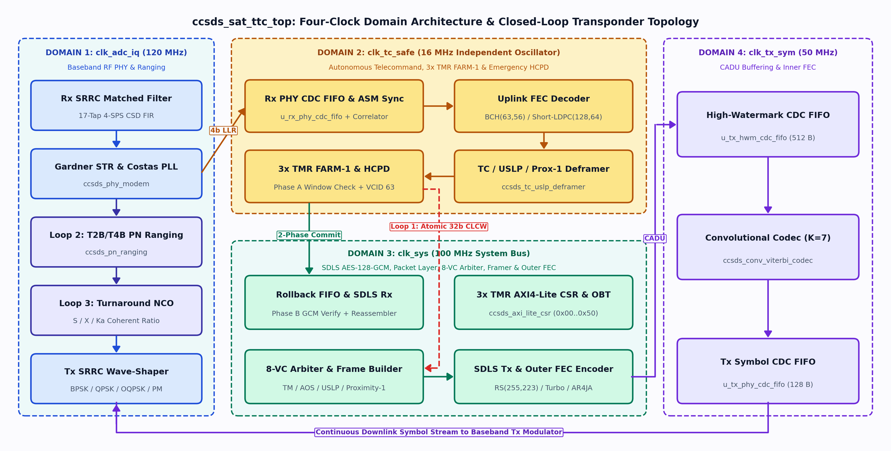
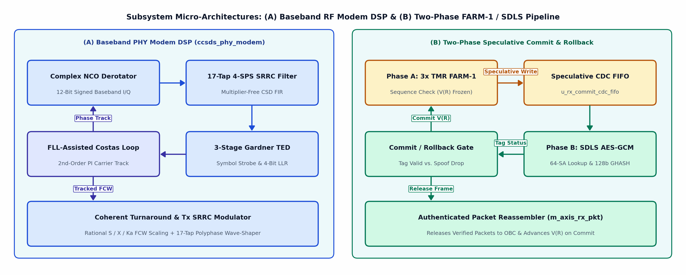
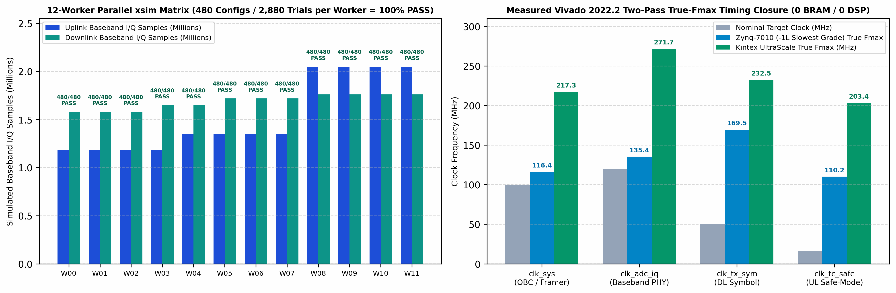
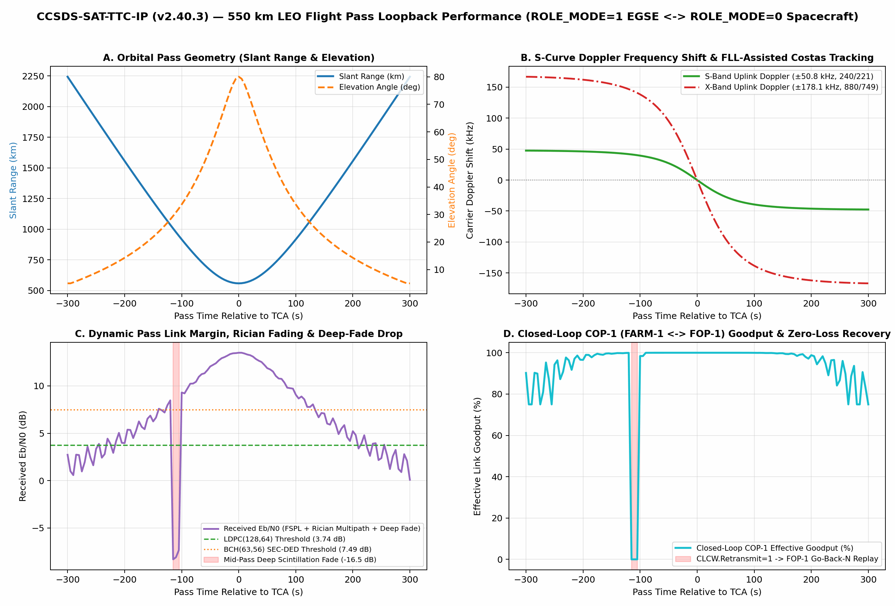
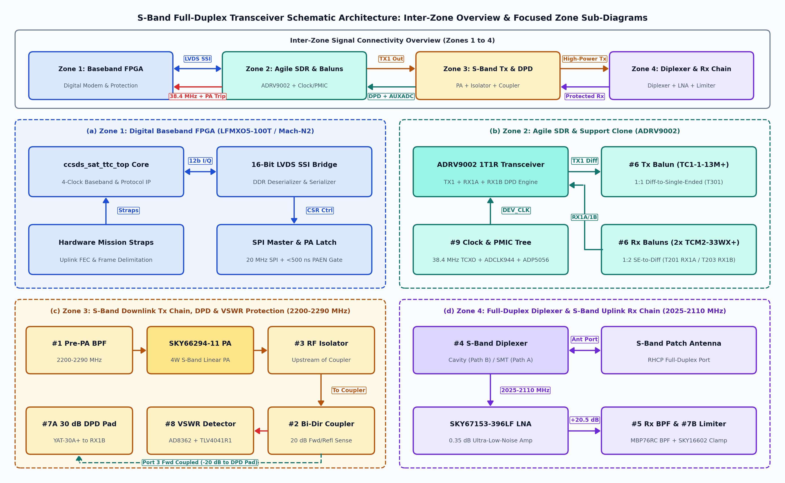

# CCSDS-SAT-TTC-IP (`v2.40.3`): Spacecraft & Ground EGSE TT&C Product Guide and User Manual

| Document Control | Details |
| :--- | :--- |
| **Document ID** | `PG-CCSDS-TTC-v2.40.3` |
| **IP Core Name** | `ccsds_sat_ttc_top` (`CCSDS-SAT-TTC-IP`) |
| **Version & Release Date** | `v2.40.3` — October 30, 2026 (All Stages 0–12 & 34,560-Trial Stage 11 Progressive RF Matrix Verified in Vivado 2022.2 `xsim` & STA) |
| **RTL Standard** | IEEE 1800-2017 SystemVerilog (`30` Synthesizable/Model RTL Modules + `11` Self-Checking Testbenches) |
| **Flight Software SDK** | ANSI/ISO C11 Bare-Metal Hardware Abstraction Layer (`sw/ccsds_ttc_hal.h`, `sw/ccsds_ttc_hal.c`, `sw/test_ccsds_ttc_hal.c`) |
| **License** | Apache License 2.0 ([`LICENSE`](../LICENSE)) |

> **Connected Two-Volume Documentation Suite (`v2.40.3`):**
> - **Volume I — Product User Guide & Integration Manual (`PG-CCSDS-TTC-v2.40.3`, this document):** Hardware pinout, compile-time parameters, FPGA sizing (`Zynq-7010/7020` & `Kintex UltraScale XQRKU060`), programmer's register map (`0x00..0x50`), bare-metal C11 HAL SDK (`sw/ccsds_ttc_hal.h/.c`), and Stage 11/12 verification sign-off.
> - **Volume II — Engineering Architecture & Mathematical Monograph ([`CCSDS_SAT_TTC_IP_ENGINEERING_BOOK.md`](CCSDS_SAT_TTC_IP_ENGINEERING_BOOK.md) / [`ccsds_ttc_ip_engineering_book.pdf`](ccsds_ttc_ip_engineering_book.pdf), `ENG-CCSDS-TTC-v2.40.3`):** Deep mathematical derivations ($GF(2^8)$ Berlekamp dual-basis bijection, $GF(2^4)$ AOS FHEC, 4-phase scaled Min-Sum LDPC, 17-tap CSD 4-SPS SRRC matched filter, 3-stage Gardner timing recovery, FLL-assisted Costas loop, and Two-Phase `FARM-1`/`SDLS` `AES-128-GCM` commit/rollback).
> - **Master RTL Specification & Audit Log:** [`ccsds_ttc_rtl_spec_and_live_plan.md`](ccsds_ttc_rtl_spec_and_live_plan.md) and [`CCSDS_IP_AUDIT_AND_ACTION_PLAN.md`](CCSDS_IP_AUDIT_AND_ACTION_PLAN.md).


---

## 1. Product Overview & Key Features

The **`CCSDS-SAT-TTC-IP` (`ccsds_sat_ttc_top`)** is a vendor-agnostic, radiation-mitigated, all-digital **Telemetry, Tracking, and Command (TT&C)** SystemVerilog IP core compliant with **17 CCSDS Blue and Orange Books**. A single unified RTL codebase is compile-time parameterized via `ROLE_MODE` and feature-enable generics to synthesize into three distinct mission personas:

1. **`ROLE_MODE = 0` (Spacecraft Flight Transceiver — 23 Modules):** Implements the complete spacecraft uplink command receiver (`Costas/FLL` + `4-SPS SRRC/Gardner` + `T2B/T4B PN Ranging` + `ASM Sync` + `BCH(63,56)` / `Short-LDPC(128,64)` + `TC/USLP/Prox-1 Deframer` + `3x TMR COP-1 FARM-1` + `NIST AES-128-CTR/GCM SDLS` + `3x TMR Emergency HCPD` + `Hsiao SECDED Commit/Rollback CDC FIFO` + `Space Packet Reassembler`) and downlink telemetry transmitter (`VC Priority Arbiter & Cycle-0 FHP` + `SDLS Encrypt/Tag` + `TM/AOS/USLP/Prox-1 Framer` + `Dual-Basis RS(255,223)` / `Turbo` / `LDPC` + `High-Watermark SECDED CDC FIFO` + `Rate-1/2 K=7 Convolutional` + `4-SPS SRRC IQ Modulator` + `S/X/Ka-Band Coherent Turnaround NCO`).
2. **`ROLE_MODE = 1` (Synthesizable Hardware Ground EGSE — 22 Modules):** Synthesizes the 17 shared core modules plus the 5 Ground Station EGSE endpoints (`ccsds_fop1_engine`, `ccsds_tc_cltu_framer`, `ccsds_bch6356_enc`, `ccsds_dl_rs255_223_dec` full $t=16$ Berlekamp-Massey/Chien/Forney decoder, and `ccsds_tm_aos_deframer`) for FlatSat racks, RFSoC ground modems, and Hardware-in-the-Loop (HIL) testbeds.
3. **`ROLE_MODE = 2` (Universal Crosslink / Relay & On-Orbit BIST Transceiver — All 28 Synthesizable Modules):** Instantiates both spacecraft flight and ground EGSE endpoints simultaneously for spacecraft-to-spacecraft [Proximity-1](https://ccsds.org/Pubs/211x0b6e1.pdf) / [USLP](https://ccsds.org/Pubs/732x1b3e1.pdf) crosslinks and autonomous on-orbit Built-In Self-Test (BIST).

---


### 1.1 Top-Level 4-Clock Transceiver Block Diagram & Closed Transponder Loops



* **Figure 1.1 Architectural Overview:** `ccsds_sat_ttc_top` partitions the transceiver across four asynchronous clock domains (`clk_adc_iq 120 MHz`, `clk_tc_safe 16 MHz`, `clk_sys 100 MHz`, and `clk_tx_sym 50 MHz`) bridged by Hsiao $(39,32)$ SECDED Gray-code FIFOs (`ccsds_cdc_fifo_ecc.sv`) and closes three real-time transponder loops: **Loop 1** (atomic 32-bit `CLCW V(R)` COP-1 ARQ feedback), **Loop 2** (wideband 6-component `T2B/T4B` regenerative PN ranging, $L=1{,}009{,}470$ chips), and **Loop 3** (coherent `S/X/Ka-Band` carrier turnaround NCO).

### 1.2 Baseband RF DSP Pipeline & Two-Phase Zero-Trust SDLS Commit/Rollback



---

## 2. Compile-Time Parameters & Mission Sizing Profiles

`ccsds_sat_ttc_top` exposes four top-level SystemVerilog parameters in `rtl/ccsds_sat_ttc_top.sv` so designers can trade optional subsystem features against FPGA LUT/FF footprint:

| Parameter | Type | Default | Allowed Values | Hardware Synthesis Effect |
| :--- | :---: | :---: | :---: | :--- |
| **`ROLE_MODE`** | `int unsigned` | `0` | `0`, `1`, `2` | Selects **Spacecraft Flight (`0`)**, **Hardware Ground EGSE (`1`)**, or **Universal Crosslink/BIST (`2`)**. |
| **`ENABLE_SDLS`** | `bit` | `1'b1` | `1'b0`, `1'b1` | When `1'b1`, synthesizes `u_sdls` (`ccsds_sdls_engine`: `AES-128-CTR`, `AES-128-GCM` $GF(2^{128})$ `GHASH`, and 64-entry Hsiao SECDED SA RAM). When `1'b0`, elides `u_sdls` with zero-latency AXI4-Stream pass-through (**saves ~7,919 LUTs and ~5,571 FFs**). |
| **`ENABLE_UL_LDPC`** | `bit` | `1'b1` | `1'b0`, `1'b1` | When `1'b1`, synthesizes `u_short_ldpc_dec` ([CCSDS 231.1-O-1](https://ccsds.org/Pubs/231x1o1s.pdf) `(128,64)` Soft-OMS iterative decoder). When `1'b0`, elides `u_short_ldpc_dec` for classic $\text{BCH}(63,56)$-only missions (**saves ~12,610 LUTs**). |
| **`ENABLE_DL_TURBO`** | `bit` | `1'b1` | `1'b0`, `1'b1` | When `1'b1`, synthesizes `u_turbo_ldpc_enc` ([CCSDS 131.0-B-5](https://ccsds.org/Pubs/131x0b5.pdf) RSC Turbo & Table 2-1 LDPC encoder). When `1'b0`, elides `u_turbo_ldpc_enc` for $\text{RS}(255,223)$/Convolutional-only downlinks. |

### 2.1 Measured Xilinx Vivado 2022.2 Resource Footprint & Device Fit Matrix

| Build Profile | Generics (`ROLE_MODE=0`) | Slice LUTs (Logic + LUTRAM) | Slice FFs | BRAM / DSP | Zynq-7010 (`xc7z010`, 17.6k LUTs) | Zynq-7020 (`xc7z020`, 53.2k LUTs) | Kintex UltraScale (`xcku040`, 242.4k) | Rad-Hard KU060 (`xqrku060`, 331.7k) |
| :--- | :--- | :---: | :---: | :---: | :---: | :---: | :---: | :---: |
| **Full Featured Flight Core** | `SDLS=1, LDPC=1, TURBO=1` | **`28,861`** (`27,661` + `1,200`) | **`13,864`** | `0 / 0` | Exceeds (`163.98%`) | **Fits (`54.25%`)** | **Fits (`11.91%`)** | **Fits (`8.70%`)** |
| **Classic BCH + AES-GCM Core** | `SDLS=1, LDPC=0, TURBO=1` | **`~16,251`** (`15,051` + `1,200`) | **`~12,732`** | `0 / 0` | **Fits (`92.34%`)** | **Fits (`30.55%`)** | **Fits (`6.70%`)** | **Fits (`4.90%`)** |
| **Compact CubeSat Core** | `SDLS=0, LDPC=0, TURBO=0` | **`~8,332`** (`7,132` + `1,200`) | **`~7,161`** | `0 / 0` | **Fits (`47.34%`)** | **Fits (`15.66%`)** | **Fits (`3.44%`)** | **Fits (`2.51%`)** |

---

## 3. Clock Domains, Reset Strategy & Measured Timing Closure (`v2.40.3`)

### 3.1 Four Asynchronous Clock Domains & Reset Architecture

The IP core operates across four independent, asynchronous clock domains separated by 2-FF `(* ASYNC_REG = "TRUE" *)` Gray-code / toggle synchronizers and dual-clock $(39,32)$ Hsiao SECDED FIFOs (`ccsds_cdc_fifo_ecc.sv`). All domains share an active-low asynchronous reset (`rst_n`) that must be deasserted synchronously or held low for at least 8 cycles of the slowest clock (`clk_tc_safe`, $\ge 500\text{ ns}$).

| Clock Port | Nominal Freq | Measured True $F_{\max}$ (`v2.32.0+`) | Nominal WNS | Push WNS ($T_{\text{push}}$) | Min Period ($T_{\min}$) | Logic Levels & Limiting Physical Critical Path |
| :--- | :---: | :---: | :---: | :---: | :---: | :--- |
| **`clk_sys`** | `100.0 MHz` (`10.000 ns`) | **`116.40 MHz`** (`+16.40%`) | **`+1.409 ns`** | `-5.258 ns` (`3.333 ns`) | **`8.591 ns`** | **`7` levels** (`u_rx_commit_cdc_fifo/rd_ptr_q_reg[0]/C -> u_csr/cnt_uncorr_err_q_reg[0]/CE`) |
| **`clk_adc_iq`** | `120.0 MHz` (`8.333 ns`) | **`135.41 MHz`** (`+12.84%`) | **`+0.948 ns`** | `-4.385 ns` (`3.000 ns`) | **`7.385 ns`** | **`9` levels** (`u_phy_modem/rx_phase_q16_reg[10]/C -> u_phy_modem/i_derot_q_reg[13]/D`) |
| **`clk_tx_sym`** | `50.0 MHz` (`20.000 ns`) | **`169.46 MHz`** (`+238.92%`) | **`+14.099 ns`** | `-2.568 ns` (`3.333 ns`) | **`5.901 ns`** | **`9` levels** (`u_tx_hwm_cdc_fifo/wr_bin_sync2_rd_q_reg[1]/C -> u_tx_hwm_cdc_fifo/rd_gray_q_reg[6]/D`) |
| **`clk_tc_safe`** | `16.0 MHz` (`62.500 ns`) | **`110.22 MHz`** (`+588.88%`) | **`+53.427 ns`** | `-5.073 ns` (`4.000 ns`) | **`9.073 ns`** | **`11` levels** (`u_ul_deframer/cur_tc_hdr_q_reg[vcid][4]/C -> u_farm1/clcw_scheduled_out_reg[wait_flag]/D`) |

---

## 4. Top-Level Pinout & Interface Specification (`ccsds_sat_ttc_top`)

| Signal Group | Port Name | Dir | Width | Clock Domain | Description |
| :--- | :--- | :---: | :---: | :---: | :--- |
| **Clocks & Reset** | `clk_sys` | In | 1 | `clk_sys` | System packet, framing, outer FEC & AXI4-Lite CSR clock (`100 MHz` nominal). |
| | `clk_tc_safe` | In | 1 | `clk_tc_safe` | Independent radiation-safe telecommand & emergency HCPD clock (`16 MHz` nominal). |
| | `clk_tx_sym` | In | 1 | `clk_tx_sym` | Downlink symbol & inner convolutional coding clock (`50 MHz` nominal). |
| | `clk_adc_iq` | In | 1 | `clk_adc_iq` | Wideband RF front-end ADC/DAC sample & PN ranging clock (`120 MHz` nominal). |
| | `rst_n` | In | 1 | Async | Active-low reset (`0` = reset all state machines & FIFOs; `1` = normal operation). |
| **AXI4-Lite CSR Slave** | `s_axi_awvalid`, `s_axi_awready` | In/Out | 1 | `clk_sys` | AXI4-Lite write address handshake. |
| | `s_axi_awaddr` | In | 8 | `clk_sys` | Byte address offset (`0x00` to `0x24`). |
| | `s_axi_wvalid`, `s_axi_wready` | In/Out | 1 | `clk_sys` | AXI4-Lite write data handshake. |
| | `s_axi_wdata`, `s_axi_wstrb` | In | 32, 4 | `clk_sys` | 32-bit write data word and 4-bit byte-lane write strobe. |
| | `s_axi_bvalid`, `s_axi_bready`, `s_axi_bresp` | Out/In/Out | 1, 1, 2 | `clk_sys` | AXI4-Lite write response (`2'b00 = OKAY`). |
| | `s_axi_arvalid`, `s_axi_arready`, `s_axi_araddr` | In/Out/In | 1, 1, 8 | `clk_sys` | AXI4-Lite read address channel (`0x00` to `0x24`). |
| | `s_axi_rvalid`, `s_axi_rready`, `s_axi_rdata`, `s_axi_rresp` | Out/In/Out/Out | 1, 1, 32, 2 | `clk_sys` | AXI4-Lite 32-bit read data channel (`2'b00 = OKAY`). |
| **Mission Straps** | `link_proto_override_en` | In | 2 | `clk_sys` | `2'b00`: Use CSR `PROTO_MODE`; non-zero: hardware pin strap override (`1=TC`, `2=Prox-1`, `3=USLP`). |
| | `ul_fec_override_en` | In | 2 | `clk_tc_safe` | Uplink FEC select: `2'd0` = Direct Frame Bytes, `2'd1` = `BCH(63,56)` CLTU, `2'd2` = `Short-LDPC(128,64)`. |
| | `sdls_en_cfg`, `bc_require_sdls_cfg` | In | 1, 1 | `clk_sys` | Hardware strap OR-ed with CSR bits `[26]` and `[27]` to enforce SDLS security. |
| | `pn_ranging_en_cfg`, `pn_t4b_mode_cfg` | In | 1, 1 | `clk_adc_iq` | Enable regenerative [CCSDS 414.1-B-3](https://ccsds.org/Pubs/414x1b3e1.pdf) PN ranging (`1=T4B`, `0=T2B`). |
| | `turnaround_xband_cfg` | In | 1 | `clk_adc_iq` | When CSR `TURNAROUND_KABAND == 2'd0`, selects `0 = S-band (240/221)` or `1 = X-band (880/749)`. |
| | `mod_mode_cfg`, `line_code_cfg` | In | 2, 2 | `clk_adc_iq` | Modulation (`0=BPSK, 1=QPSK, 2=OQPSK, 3=PCM/PM`) & Line Code (`0=NRZ-L, 1=NRZ-M, 2=Bi-Phi-L`). |
| **Uplink RF & Symbol In** | `rx_i_adc_in`, `rx_q_adc_in`, `rx_iq_valid_in` | In | 12s, 12s, 1 | `clk_adc_iq` | Signed 12-bit two's-complement baseband I/Q ADC samples and sample clock-enable strobe. |
| | `s_axis_ul_sym_tvalid/tready/tdata/tlast` | In/Out | 1, 1, 8, 1 | `clk_tc_safe` | Uplink soft-LLR symbol (`tdata[3:0]`) or direct frame byte stream into RX2/RX3/RX4. |
| **OBC Packet Rx Master** | `m_axis_rx_pkt_tvalid/tready/tdata/tlast/tuser` | Out/In | 1, 1, 8, 1, 64 | `clk_sys` | Validated, decrypted, reassembled Space Packet output stream to Spacecraft OBC DMA. |
| **OBC Packet Tx Slave** | `s_axis_tx_pkt_tvalid/tready/tdata/tlast/tuser` | In/Out | 1, 1, 8, 1, 64 | `clk_sys` | Downlink Telemetry Space Packet ingress from Spacecraft OBC (`tuser.vcid[2:0]` selects VC `0..7`). |
| **Downlink CADU & IQ Out**| `m_axis_dl_cad_tvalid/tready/tdata/tlast` | Out/In | 1, 1, 8, 1 | `clk_tx_sym` | Zero-bubble scrambled & FEC-encoded Downlink CADU byte stream. |
| | `tx_i_dac_out`, `tx_q_dac_out`, `tx_iq_valid_out` | Out | 12s, 12s, 1 | `clk_adc_iq` | Signed 12-bit baseband I/Q DAC samples (pulse-shaped SRRC or 1-SPS + regenerative PN chip on Q). |
| **Emergency & EDAC** | `hcpd_obc_reset_pulse`, `hcpd_safe_mode_force`, `hcpd_rf_chain_select` | Out | 1, 1, 2 | `clk_tc_safe` | Direct hardware emergency command outputs from 3x TMR `ccsds_hcpd_ctrl` (`VCID=63`). |
| | `pn_All_Locked_out` | Out | 1 | `clk_adc_iq` | Asserted high when all 6 PN ranging components ($C_1..C_6$, $L=1,009,470$) achieve correlation lock. |
| | `fault_irq_out`, `edac_scrub_req_out` | Out | 1, 1 | `clk_sys` | Uncorrectable fault interrupt to OBC and SEU scrub request to FPGA configuration scrubber (e.g., Xilinx SEM). |

---

### 4.1 Hardware Mission Straps & Uplink FEC Architecture (Anti-Deadlock Design)

A critical architectural distinction in `ccsds_sat_ttc_top` is that **Downlink FEC is software-programmable via CSR `0x04`**, while **Uplink FEC is controlled via dedicated hardware mission strap pins (`ul_fec_override_en[1:0]`)**:

#### 1. Spacecraft "Chicken-and-Egg" Deadlock Prevention
* **Downlink Telemetry**: Originates from the spacecraft OBC software. Because software must be executing to generate telemetry packets, software control via AXI4-Lite CSR `0x04` (`FEC_MODE` bits `[19:16]`) is safe, natural, and flexible.
* **Uplink Telecommand**: Represents the spacecraft's vital lifeline. If the OBC CPU freezes, encounters a bus hang, enters an unbooted ROM state, or suffers radiation-induced firmware corruption, it cannot perform AXI4-Lite CSR transactions.
* **Anti-Deadlock Principle**: If Uplink FEC were controlled through software registers, ground control could **never** send an emergency recovery command to a dead spacecraft because the receiver would be unconfigured. Dedicated hardware pins ensure the receiver's FEC state is deterministic at hardware power-on.

#### 2. Domain Isolation (`clk_tc_safe` vs. `clk_sys`)
* The AXI4-Lite CSR bus operates in `clk_sys` ($100\text{ MHz}$).
* The uplink receiver operates in `clk_tc_safe` ($16\text{ MHz}$), powered by an independent, radiation-hardened oscillator.
* Driving `ul_fec_override_en[1:0]` directly ensures that the 16-bit BCH correlator (`0xEB90`), 64-bit LDPC correlator, and 3x TMR **Hardware Command Pulse Decoder (HCPD, `VCID=63`)** are active and responsive immediately upon reset.

#### 3. Uplink FEC Modes & Capabilities
| Strap Value (`ul_fec_override_en`) | Uplink FEC Architecture | Applicable Standard | Coding Gain | Framing & Sync Markers | Ideal Use Case |
| :---: | :--- | :--- | :---: | :--- | :--- |
| **`2'b00`** | **Direct / Uncoded Mode** | None (Raw Bytes) | $0\text{ dB}$ | In-Band Header Length + `s_axis_ul_sym_tlast` | FlatSat testing, RF cable loopback, high-SNR testbeds |
| **`2'b01`** | **Expurgated $\text{BCH}(63,56)$ SEC-DED** | **CCSDS 231.0-B-4** | $\approx 1.8\text{ dB}$ | 16-bit ASM (`0xEB90`) + 64-bit Tail (`0xC5..79`) | Standard LEO/GEO missions, universal ground station compatibility |
| **`2'b10` / `2'b11`** | **Short-Block QC-LDPC $(128,64)$** | **CCSDS 231.1-O-1** | $\approx 7.2\text{ dB}$ | 64-bit ASM (`0x0347..`) + 64-bit Tail (`0x55..AA`) | Deep-space, CubeSat omni antennas, tumbling attitude safe-mode |

#### 4. Frame Delimitation in Uncoded Mode
In Uncoded Mode (`2'b00`), where no CLTU Start or Tail markers exist, frame boundaries are established via:
* **Primary Header Length Field**: The hardware deframer (`ccsds_tc_uslp_deframer.sv`) extracts the self-declared length from the 5-byte TC header ($L = \text{frame\_len} + 1$), Proximity-1 header ($L = \text{frame\_len} + 5$), or USLP header, counting bytes from 1 to $L$ before running the CRC-16/CRC-32 check.
* **Streaming `tlast` Verification**: The `s_axis_ul_sym_tlast` signal validates packet boundaries; an early or late `tlast` aborts the malformed frame without state mutation.

#### 5. Interaction with Compile-Time Parameter `ENABLE_UL_LDPC`
* If `ENABLE_UL_LDPC = 1'b0` at synthesis, the ~12,610 LUT Offset Min-Sum (OMS) decoder is omitted from the FPGA bitstream, tying decoder outputs to zero.
* If a designer accidentally drives `ul_fec_override_en = 2'd2` while `ENABLE_UL_LDPC = 0`, the receiver cleanly idles (`tvalid = 0`). It drops incoming LDPC frames without asserting false valid pulses, corrupting memory, or locking the pipeline.

#### 6. Dynamic Flight Software Control (Optional Integration)
If a mission requires OBC software to switch uplink FEC modes on orbit:
1. Connect `ul_fec_override_en[1:0]` to an external FPGA GPIO or system control register.
2. Synchronize the signals into `clk_tc_safe` via a standard 2-FF synchronizer.
3. Include an OBC watchdog timer fallback that automatically restores `ul_fec_override_en` to hardware default ($	ext{BCH}$ or $	ext{LDPC}$) if the OBC stops servicing the watchdog.

---

### 4.2 Space Data Link Security (SDLS) Integration & Two-Phase Anti-Replay Architecture

The **CCSDS 355.0-B-2 Space Data Link Security (SDLS)** cryptographic subsystem (`ccsds_sdls_engine.sv`) secures both uplink telecommand and downlink telemetry streams against eavesdropping, spoofing, tampering, and replay attacks.

#### 1. Compile-Time Feature Scaling (`parameter ENABLE_SDLS`)
* **`ENABLE_SDLS = 1'b1` (Default)**: Instantiates the full synthesizable NIST FIPS-197 AES-128 core, NIST SP 800-38D AES-128-GCM $GF(2^{128})$ `GHASH` engine, 64-entry Hsiao $(39,32)$ SECDED SA RAM, and 16-byte lookahead tag pipelines.
* **`ENABLE_SDLS = 1'b0` (Compact CubeSat)**: Physically elides the cryptographic engine from the netlist, **saving ~7,919 Slice LUTs and ~5,571 Slice FFs**.
* **Synthesis vs. Runtime Bypass Behavior**: If an FPGA bitstream built with `ENABLE_SDLS = 0` has its hardware strap (`sdls_en_cfg = 1`) or CSR (`CTRL_SCID_PROTO[26] = 1`) asserted at runtime, the RTL generate block `g_no_sdls_engine` activates zero-latency wire pass-throughs and hardwires `sdls_auth_ok = 1'b1`. Frames flow cleanly through the pipeline in cleartext without waiting for cryptographic handshakes or stalling the bus.

#### 2. Runtime Security Suite Selection
* **SDLS Enforcement**: Controlled by hardware pin strap `sdls_en_cfg` OR-ed with CSR `CTRL_SCID_PROTO[26]`.
* **Cryptographic Suite Mode (`CTRL_USLP_RS_CFG[28]`, `SDLS_GCM_MODE`)**:
  * **`0` = AES-128-CTR**: Standard payload encryption with a lightweight 1-byte MAC tag.
  * **`1` = Full NIST SP 800-38D AES-128-GCM**: Authenticated Encryption with Associated Data (AEAD) utilizing a 128-bit $GF(2^{128})$ `GHASH` tag computed over the 6-byte Security Header (`{SPI, Seq}`) and ciphertext blocks.
* **Type-BC Control Frame Exemption (`CTRL_SCID_PROTO[27]`, `BC_REQ_SDLS`)**:
  * In compliance with CCSDS 355.0-B-2 Section 3.3.2.3, critical COP-1 control frames (`Unlock` and `Set V(R)`) can be exempted from SDLS encryption.
  * Setting `BC_REQ_SDLS = 0` allows unencrypted Type-BC recovery commands to break an on-orbit communications deadlock if cryptographic keys or counter state get out of sync. Setting `1` enforces authentication across all frames.

#### 3. Zero-Trust Two-Phase FARM-1 $\leftrightarrow$ SDLS Commit/Rollback Architecture
In standard CCSDS implementations, COP-1 `FARM-1` advances its expected sequence number $V(R)$ the moment an incoming frame passes CRC. If cryptographic authentication happens *after* $V(R)$ advances, an attacker transmitting tampered frames with valid sequence numbers forces $V(R)$ forward. When the cryptographic MAC check fails, the payload is discarded, but $V(R)$ has already stepped, permanently locking out legitimate ground transmissions (an Anti-Replay Denial-of-Service attack).

`ccsds_sat_ttc_top` resolves this vulnerability through a **Two-Phase Commit/Rollback protocol**:
1. **Phase A (Pre-Check)**: `FARM-1` validates that $N(S)$ falls within the valid sliding window $[V(R) .. V(R)+W-1]$, but **holds $V(R)$ frozen**. The raw frame octets stream into a speculative, swipe-proof Hsiao $(39,32)$ SECDED FIFO (`ccsds_cdc_fifo_ecc.sv`).
2. **Phase B (Cryptographic Evaluation)**: The `ccsds_sdls_engine` evaluates the 128-bit GHASH tag and checks the 32-bit monotonic anti-replay sequence counter against the Security Association table.
3. **Commit or Rollback**:
   * **Authenticated**: `sdls_commit_pulse` asserts. `FARM-1` commits $V(R) \leftarrow V(R) + 1$, advances the FIFO read pointer, updates the outgoing `CLCW V(R)` report, and releases the decrypted Space Packet to the OBC.
   * **Spoofed / Tampered**: `sdls_rollback_pulse` asserts. `FARM-1` leaves $V(R)$ completely unchanged, the FIFO rewinds its speculative read pointer to discard the corrupt bytes, and the saturating register `FAULT_ERR_CNTS[31:16]` (`SDLS_MAC_ERR_CNT`) increments.

#### 4. Security Association (SA) Provisioning & Zeroization
* **Master Key Loading**: Supports runtime loading of 256-bit master keys across CSR registers `0x28..0x34`.
* **64-Entry SA Table**: Configured via CSR registers `0x38..0x50` with individual Security Parameter Indexes (SPI), operational keys, and 32-bit anti-replay thresholds.
* **Single-Cycle Hardware Zeroization**: An active zeroization strobe flushes the internal key registers and 64-SA ECC RAM with zeros in a single clock cycle.

---

## 5. Complete Programmer's Register Map (`rtl/ccsds_axi_lite_csr.sv`)

All configuration registers (`0x04`, `0x08`, `0x0C`) are stored in **3x Triple Modular Redundant (TMR)** flip-flop banks (`*_a_q`, `*_b_q`, `*_c_q`) with continuous single-cycle majority-vote scrubbing (`SVA-CSR-4`). The register map below is 100% bit-exact with `rtl/ccsds_axi_lite_csr.sv` and `sw/ccsds_ttc_hal.h`.

| Offset | Register Name | Access | Reset Value | Bitfield Layout & Hardware Description |
| :---: | :--- | :---: | :---: | :--- |
| **`0x00`** | `CORE_ID_VER` | RO | `0xCC5D_0230` | `[31:16]` Magic ID (`16'hCC5D`), `[15:0]` Core Architecture Version (`16'h0230`). |
| **`0x04`** | `CTRL_SCID_PROTO` | R/W (3x TMR) | `0x0131_5155` | • `[9:0]` `SCID_10B`: 10-bit Spacecraft ID for TC/TM/Prox-1 (`10'h155` default)<br>• `[14:12]` `PROTO_MODE`: `3'd0`=TM, `3'd1`=AOS, `3'd2`=Prox-1, `3'd3`=USLP, `3'd4`=TC<br>• `[19:16]` `FEC_MODE`: `4'd0`=RS(255,223), `4'd1..4`=Turbo ($r=1/2, 1/3, 1/4, 1/6$)<br>• `[20]` `OCF_EN`: Enable 32-bit OCF (`CLCW`/`PLCW`) injection/extraction<br>• `[21]` `FECF_EN`: Enable 16/32-bit Frame Error Control Field CRC<br>• `[22]` `FECF_CRC32`: `0`=CRC-16-CCITT (`0x1021`), `1`=Proximity-1/USLP CRC-32 (`0x00A00805`)<br>• `[23]` `AOS_FHEC_EN`: Enable AOS 16-bit $GF(2^4)$ $\text{RS}(10,6)$ Frame Header Error Control<br>• `[24]` `TC_SEG_HDR_EN`: TC 8-bit Segment Header present on Type-AD/BD frames<br>• `[25]` `OBT_SEC_HDR_EN`: Enable 8-byte [CCSDS 301.0-B-4](https://ccsds.org/Pubs/301x0b4e1.pdf) CUC On-Board Time TM Secondary Header<br>• `[26]` `SDLS_EN`: Enable inline [CCSDS 355.0-B-2](https://ccsds.org/Pubs/355x0b2.pdf) SDLS encryption/authentication<br>• `[27]` `BC_REQ_SDLS`: `0`=Exempt Type-BC `Unlock`/`Set V(R)` per Sec 3.3.2.3; `1`=Require SDLS on Type-BC<br>• `[28]` `SRRC_4SPS_EN`: Enable 4-SPS 17-Tap ($\alpha=0.35$) SRRC Tx Pulse-Shaping & Rx Matched Filter<br>• `[29]` `GARDNER_TED_EN`: Enable closed-loop 4-SPS Gardner / Nyquist Zero-ISI Symbol Timing Recovery<br>• `[31:30]` `TURNAROUND_KABAND`: `2'd0`=Use `turnaround_xband_cfg` (`0`=S-band $240/221$, `1`=X-band $880/749$), `2'd1`=Ka-band Cat-B ($3344/749$), `2'd2`=Ka-band Cat-A ($3360/749$) |
| **`0x08`** | `CTRL_USLP_RS_CFG` | R/W (3x TMR) | `0x0001_4255` | • `[15:0]` `USLP_SCID_16B`: 16-bit Spacecraft ID for USLP frames (`16'h4255` default)<br>• `[19:16]` `RS_INTERLEAVE_I`: Dual-basis $\text{RS}(255,223)$ interleaving depth $I \in \{1,2,3,4,5,8\}$<br>• `[27:20]` `RS_VIRT_FILL_Q`: Implicit virtual fill symbols $Q \in [0..200]$ per RS codeword<br>• `[28]` `SDLS_GCM_MODE`: `0`=`AES-128-CTR` (1B tag), `1`=Full NIST SP 800-38D `AES-128-GCM` (128-bit `GHASH` tag)<br>• `[29]` `FLL_ASSIST_EN`: Enable sign-quantized Differential Cross-Product FLL-Assisted Costas carrier pull-in |
| **`0x0C`** | `CTRL_COP1_TFDF_CFG` | R/W (3x TMR) | `0x010D_F010` | • `[7:0]` `WINDOW_HALF_W`: COP-1 `FARM-1` / COP-P sliding window half-width $W$ (`8'd16` default)<br>• `[18:8]` `TFDF_BYTE_LEN`: Downlink Transfer Frame Data Field byte length (`11'd223` default)<br>• `[24]` `FAULT_IRQ_EN`: Master interrupt enable for `fault_irq_out` |
| **`0x10`** | `OBT_COARSE_SEC` | R/W | `0x6530_0000` | `[31:0]` [CCSDS 301.0-B-4](https://ccsds.org/Pubs/301x0b4e1.pdf) CUC On-Board Time Coarse Seconds (increments on `pps_1hz_pulse` or internal $1\text{ Hz}$ divider). |
| **`0x14`** | `OBT_FINE_SUBSEC` | R/W | `0x0000_0000` | `[15:0]` CUC On-Board Time Fine Sub-Seconds ($2^{-16}\text{ s} \approx 15.26\,\mu\text{s}$ resolution). |
| **`0x18`** | `EDAC_CORR_CNTS` | RO / W1C | `0x0000_0000` | • `[15:0]` `SECDED_CORR_CNT`: Saturating 16-bit counter of corrected 1-bit BCH & Hsiao SECDED errors (Write `1` to bit `0` to clear)<br>• `[31:16]` `TMR_SEU_CORR_CNT`: Saturating 16-bit counter of scrubbed TMR SEU bit-flips across `CSR`, `FARM-1`, and `HCPD` (Write `1` to bit `16` to clear) |
| **`0x1C`** | `FAULT_ERR_CNTS` | RO / W1C | `0x0000_0000` | • `[15:0]` `UNCORR_ERR_CNT`: Saturating 16-bit counter of uncorrectable 2-bit BCH/SECDED, Frame CRC, and Packet Length errors (Write `1` to bit `0` to clear)<br>• `[31:16]` `SDLS_MAC_ERR_CNT`: Saturating 16-bit counter of rejected SDLS MAC/GCM tag or anti-replay frames (Write `1` to bit `16` to clear) |
| **`0x20`** | `LATEST_CLCW_MON` | RO | `0x0000_0000` | `[31:0]` Latest 32-bit [CCSDS 232.1-B-2](https://ccsds.org/Pubs/232x1b2e2c1.pdf) Communications Link Control Word (`CLCW`) scheduled by `u_farm1` (`[7:0]` = $V(R)$ `report_value`, `[10]` = `retransmit`, `[11]` = `wait`, `[12]` = `lockout`). |
| **`0x24`** | `LATEST_PLCW_MON` | RO | `0x0000_0000` | `[31:0]` Latest 32-bit [CCSDS 211.0-B-6](https://ccsds.org/Pubs/211x0b6e1.pdf) Proximity Link Control Word (`PLCW`) scheduled by `u_prox1_plcw`. |

---

## 6. Flight & Ground EGSE Software Integration Guide (Bare-Metal C11 HAL SDK)

The repository ships with a zero-dependency, `MISRA-C`/`C11`-clean Hardware Abstraction Layer in `sw/ccsds_ttc_hal.h` and `sw/ccsds_ttc_hal.c` (verified by `sw/test_ccsds_ttc_hal.c` via `make hal-test`).

### 6.1 Step-by-Step Spacecraft Flight Core (`ROLE_MODE = 0`) Initialization Example

```c
#include "ccsds_ttc_hal.h"

void obc_ttc_flight_init(uintptr_t axi_csr_base_addr) {
    ccsds_ttc_dev_t ttc_dev;

    // 1. Attach to AXI4-Lite CSR base address and verify CORE_ID_VER == 0xCC5D0230
    ccsds_hal_status_t st = ccsds_ttc_init(&ttc_dev, axi_csr_base_addr, NULL, NULL);
    if (st != CCSDS_HAL_OK) {
        // Handle bus fault or unexpected IP version
        return;
    }

    // 2. Configure Spacecraft Mission Profile:
    //    - SCID = 0x155 (10-bit), USLP SCID = 0x4255 (16-bit)
    //    - Protocol = Classic TM/TC (CCSDS_PROTO_TM), Outer FEC = Dual-Basis RS(255,223) (I=1, Q=195)
    //    - Enable OCF (CLCW), FECF (CRC-16), TC Segment Header, and 8-byte CUC OBT Secondary Header
    //    - Enable Inline SDLS with Full 128-bit NIST SP 800-38D AES-128-GCM (GHASH)
    //    - Enable 4-SPS 17-Tap SRRC + Closed-Loop 4-SPS Gardner STR + FLL-Assisted Costas + Ka-Band Cat-B (3344/749)
    ccsds_ttc_config_t cfg = {
        .scid_10b          = 0x155u,
        .uslp_scid_16b     = 0x4255u,
        .proto_mode        = CCSDS_PROTO_TM,
        .fec_mode          = CCSDS_FEC_RS255_223,
        .ocf_en            = true,
        .fecf_en           = true,
        .fecf_crc32        = false,
        .aos_fhec_en       = false,
        .tc_seg_hdr_en     = true,
        .obt_sec_hdr_en    = true,
        .sdls_en           = true,
        .bc_require_sdls   = false, // Exempt Type-BC Unlock/Set V(R) per CCSDS 355.0-B-2 Sec 3.3.2.3
        .srrc_4sps_en      = true,
        .gardner_ted_en    = true,
        .fll_assist_en     = true,
        .sdls_gcm_mode     = true,  // 128-bit AES-128-GCM authentication tag
        .turnaround_kaband = CCSDS_TURNAROUND_KA_CAT_B_3344_749,
        .rs_interleave_i   = 1u,
        .rs_virt_fill_q    = 195u,  // 28B TM frame -> 60B shortened RS codeword
        .cop1_window_w     = 16u,
        .tfdf_byte_len     = 16u,
        .fault_irq_en      = true
    };
    (void)ccsds_ttc_configure(&ttc_dev, &cfg);

    // 3. Synchronize 48-bit CCSDS 301.0-B-4 CUC On-Board Time (OBT) at GPS 1-PPS edge
    (void)ccsds_ttc_set_obt(&ttc_dev, 0x65300042u, 0x8000u);
}
```

### 6.2 Polling Live COP-1 `CLCW` & Scrubbing Radiation EDAC Telemetry

```c
void obc_ttc_1hz_health_check(const ccsds_ttc_dev_t *ttc_dev) {
    ccsds_ttc_clcw_t clcw;
    ccsds_ttc_telemetry_t tlm;

    // Decode live 32-bit COP-1 CLCW from offset 0x20
    (void)ccsds_ttc_read_clcw(ttc_dev, &clcw);

    // Read EDAC & Fault counters (0x18, 0x1C) and 48-bit CUC OBT (0x10, 0x14)
    (void)ccsds_ttc_get_telemetry(ttc_dev, &tlm);

    if (tlm.tmr_seu_corr_cnt > 0u || tlm.secded_corr_cnt > 0u) {
        // Log radiation event to spacecraft housekeeping telemetry and clear W1C counters
        (void)ccsds_ttc_clear_edac_counters(ttc_dev, true, true);
    }
}
```


---

### 6.3 Firmware Configuration Gating & Valid vs. Invalid CCSDS Combinations (`v2.40.3`)

Before committing any AXI4-Lite register writes to `0x04..0x0C`, `ccsds_ttc_hal_configure()` automatically invokes `ccsds_ttc_hal_validate_config(const ccsds_ttc_config_t *cfg)` in `sw/ccsds_ttc_hal.c` to enforce **8 CCSDS Blue Book configuration gating rules**. Any illegal or non-standard parameter cross-combination is rejected immediately with a negative status code without modifying hardware state:

| Rule # | HAL Status Code | Gated Parameter Combination | Governing CCSDS Standard & Rationale |
| :---: | :--- | :--- | :--- |
| **1** | `CCSDS_HAL_ERR_MOD_LINE_INCOMPAT` (`-10`) | `MOD_QPSK` or `MOD_OQPSK` paired with `LINE_BIPHI_L` | [CCSDS 401.0-B-32](https://ccsds.org/Pubs/401x0b32.pdf): Manchester (`Bi-Phi-L`) split-phase coding is valid only for 1-bit/symbol BPSK or residual-carrier PCM/PSK/PM. Only **10 of the 12** `(Modulation x Line-Code)` combinations are flight-valid. |
| **2** | `CCSDS_HAL_ERR_SRRC_BIPHI_INCOMPAT` (`-11`) | `srrc_4sps_en = true` paired with `LINE_BIPHI_L` | [CCSDS 401.0-B-32](https://ccsds.org/Pubs/401x0b32.pdf): 4-SPS Square-Root Raised-Cosine ($\alpha = 0.35$) baseband pulse shaping applies only to `NRZ-L` and `NRZ-M` waveforms. |
| **3** | `CCSDS_HAL_ERR_GARDNER_REQUIRES_4SPS` (`-12`) | `gardner_ted_en = true` when `srrc_4sps_en = false` | Closed-loop 4-SPS Gardner / Nyquist Zero-ISI symbol timing recovery requires 4-SPS SRRC matched filter samples (`mf_i_q`/`mf_q_q`). |
| **4** | `CCSDS_HAL_ERR_PROTO_FEC_INCOMPAT` (`-13`) | • `PROTO_TC` with `RS(255,223)` / `Turbo` / `AR4JA`<br>• `PROTO_TM` or `PROTO_AOS` with `BCH(63,56)` / `LDPC_UL`<br>• `PROTO_PROX1` with `BCH` / `RS` / `Turbo` | [CCSDS 231.0-B-4](https://ccsds.org/Pubs/231x0b4.pdf) & [131.0-B-5](https://ccsds.org/Pubs/131x0b5.pdf): Uplink telecommand uses `BCH(63,56)` or `Short-LDPC(128,64)/(512,256)`; Downlink TM/AOS uses `RS(255,223)`, `Conv(K=7)`, or `Turbo`; `USLP` (`732.1-B-3`) is unified bidirectional. |
| **5** | `CCSDS_HAL_ERR_CRC32_PROTO_INCOMPAT` (`-14`) | • `fecf_crc32 = true` on `PROTO_TM`, `PROTO_AOS`, or `PROTO_TC`<br>• `fecf_crc32 = false` on `PROTO_PROX1` (`fecf_en=1`) | [CCSDS 211.0-B-6](https://ccsds.org/Pubs/211x0b6.pdf): 32-bit FECF (`0x00A00805`) is mandatory on Proximity-1 and optional on USLP; TM, AOS, and TC strictly mandate 16-bit CRC-16-CCITT (`0x1021`). |
| **6** | `CCSDS_HAL_ERR_AOS_FHEC_INCOMPAT` (`-15`) | `aos_fhec_en = true` when `proto_mode` is not `PROTO_AOS` or `PROTO_USLP` | [CCSDS 732.0-B-4](https://ccsds.org/Pubs/732x0b4.pdf): 16-bit $GF(2^4)$ RS(10,6) Frame Header Error Control (FHEC) exists only in the AOS header. |
| **7** | `CCSDS_HAL_ERR_RS_PARAM_RANGE` (`-16`) | `rs_interleave_i` $\notin \{1,2,3,4,5,8\}$ or `rs_virt_fill_q > 215` | [CCSDS 131.0-B-5](https://ccsds.org/Pubs/131x0b5.pdf): Dual-basis RS(255,223) supports interleaving depths $I \in \{1,2,3,4,5,8\}$ and requires at least 8 information octets ($223 - Q \ge 8$). |
| **8** | `CCSDS_HAL_ERR_FRAME_LEN_RANGE` (`-17`) | `tfdf_byte_len` $\notin [1..1024]$ or `window_half_w` $\notin [1..128]$ | Hardware buffer & COP-1 sliding-window bounds check. |

### 6.4 Stage 11 12-Thread Parallel 5,760-Configuration Valid RF Matrix (`scripts/run_stage11_matrix_parallel.py`)

All **480 valid end-to-end chip-to-chip RF configurations** across `u_ground_egse_top (ROLE_MODE=1, IQ_BUS_WIDTH=16)` and `u_spacecraft_top (ROLE_MODE=0, IQ_BUS_WIDTH=16)` (`sc_ul_sym_tvalid == 1'b0`) are swept automatically across **12 parallel `xsim` worker threads** (`40` configurations per thread = `960` true 16-bit RF packet transfers):

* **10 Valid `(Modulation x Line-Code)` Waveforms**: `BPSK+{NRZ-L, NRZ-M, Bi-Phi-L}`, `QPSK+{NRZ-L, NRZ-M}`, `OQPSK+{NRZ-L, NRZ-M}`, and `PCM/PM+{NRZ-L, NRZ-M, Bi-Phi-L}` (`QPSK/OQPSK + Bi-Phi-L` excluded & firmware-gated).
* **4 Coherent Turnaround Bands**: **S-Band ($240/221$)**, **X-Band ($880/749$)**, **Ka-Band Deep-Space Cat-B ($3344/749$)**, and **Ka-Band Near-Earth Cat-A ($3360/749$)**.
* **3 Variable Uplink Telecommand Packet/Frame Sizes**: **Short (`8B` Space Packet $\rightarrow$ `3` BCH codeblocks, `320` RF I/Q samples)**, **Medium (`14B` Space Packet $\rightarrow$ `4` BCH codeblocks, `384` RF I/Q samples)**, **Long (`28B` Space Packet $\rightarrow$ `6` BCH codeblocks, `512` RF I/Q samples)**.
* **4 Variable Downlink Telemetry Frame/OBT/Randomizer Modes**: **Short (`10B` Packet, `58B` CADU, `Q=201`, Rand OFF)**, **Medium (`16B` Packet, `64B` CADU, `Q=195`, Rand ON)**, **Medium + 48-Bit CUC OBT Secondary Header (`16B` Packet + `8B` OBT, `72B` CADU, `Q=187`, Rand ON)**, and **Long (`32B` Packet, `80B` CADU, `Q=179`, Rand ON)**.

```powershell
# 1. Run all 5,760 valid chip-to-chip RF configurations across 12 parallel Vivado xsim threads (1 trial/config = 11,520 RF packets):
.\scripts\run_stage11_matrix_parallel.bat 12 1 auto

# 2. Run all 5,760 valid configurations x 6 Progressive OAT + Combined Mission Envelope Monte Carlo trials/config (34,560 trials = 69,120 RF packets):
.\scripts\run_stage11_matrix_parallel.bat 12 6 progressive
```

#### 6.4.1 Full 5,760 Valid System Configuration Space (`480 PHY/Frame Slice x 12 Protocol/FEC/SDLS Combinations`)

| Dimension | Valid Options | Count |
| :--- | :--- | :--- |
| **1. PHY Modulation x Line Code** | `BPSK`/`PCM-PM` x `{NRZ-L, NRZ-M, Bi-Phi-L}` + `QPSK`/`OQPSK` x `{NRZ-L, NRZ-M}` | **10** |
| **2. Coherent Turnaround Band** | `S-Band (240/221)`, `X-Band (880/749)`, `Ka Cat-B (3344/749)`, `Ka Cat-A (3360/749)` | **4** |
| **3. Uplink Variable Packet/CLTU Length** | `8 B`, `14 B`, `28 B` Space Packets (`3..7` BCH/LDPC codeblocks) | **3** |
| **4. Downlink Variable Frame/OBT/Rand** | `10 B (Unrand)`, `16 B (+Rand)`, `16 B (+OBT/FHEC+Rand)`, `32 B (+Rand)` | **4** |
| **5. Uplink Channel Coding (CCSDS 231.0-B-4)** | `Expurgated BCH(63,56) SEC` (`ul_fec=0`), `Short-Block QC-LDPC(128,64) Soft-OMS` (`ul_fec=1`) | **2** |
| **6. Downlink Framing Protocol** | `TM` (`CCSDS 132.0-B-3`), `AOS` (`CCSDS 732.0-B-4`), `USLP` (`CCSDS 732.1-B-2`) | **3** |
| **7. Link Security (CCSDS 355.0-B-2)** | `Clear Bypass` (`sdls_en=0`), `SDLS AES-128-CTR + MAC Authenticated` (`sdls_en=1`) | **2** |
| **Total Valid System Configurations** | $10 \times 4 \times 3 \times 4 \times 2 \times 3 \times 2$ | **5,760 (`100%`)** |

#### 6.4.2 Progressive One-At-a-Time (OAT) Isolation + Combined Mission Envelope Methodology (ECSS-E-ST-50-05C / CCSDS 401.0-B)

To provide both **subsystem fault isolation** (identifying which receiver loop caused any degradation) and **cross-coupled worst-case margin verification**, Stage 11 (`tb/tb_stage11_top_to_top_rf_link.sv`) wires `ccsds_space_flight_channel_model` into both the Uplink and Downlink 16-bit AD9361 Baseband I/Q paths (with 4 continuously advancing CLT Gaussian AWGN LFSRs that never reset across trials) and maps each trial (`trial_idx = 0 .. MC_ITERS-1`) through 6 channel profiles:

| Profile ID | Profile Name | Active RF Channel Impairments (`u_ul_rf_channel` & `u_dl_rf_channel`) | Receiver Loop / Subsystem Isolated |
| :--- | :--- | :--- | :--- |
| **`P0`** | `P0_CLEAN_REF` | Minimal thermal AWGN (`sigma=4`), `0` CFO, `0` delay, ideal RF front-end | Baseline framing (`TC`/`TM`/`AOS`/`USLP`), FEC (`BCH`/`LDPC`/`RS`), `SDLS`, & `CLCW` |
| **`P1`** | `P1_OAT_AWGN_FEC` | Elevated CLT Gaussian AWGN (`sigma=24..32`) + deterministic Baseband I/Q symbol error injection (`mask=0xA5`) | Active hardware FEC error correction (`BCH(63,56)` SEC, `LDPC(128,64)` Soft-OMS, `RS(255,223)` $t=16$) |
| **`P2`** | `P2_OAT_DOPPLER_PN` | High initial CFO (`+-20..24` step) + dynamic S-curve Doppler ramp (`rate=+-2`) + Wiener oscillator phase noise | Costas PLL frequency pull-in, dynamic ramp tracking, and phase-jitter tolerance |
| **`P3`** | `P3_OAT_DELAY_MP` | Fractional slant-range delay (`prop_delay=1..7` samples) + Rician specular multipath echo (`-18..-30 dB`) | Symbol timing recovery & multipath ISI resilience |
| **`P4`** | `P4_OAT_RF_ANALOG` | SSPA soft-compression (`pa_nonlin_en=1`) + I/Q gain/quadrature skew (`iq_imbalance_en=1`) + Zero-IF ADC DC offset (`+-5..6`) | Constellation slicer symmetry, compression & DC-offset tolerance |
| **`P5`** | `P5_COMBINED_MC` | **All 6 impairments active simultaneously**: Noisy AWGN (`sigma=18..28`) + active IQ symbol error injection + S-curve Doppler ramp + Phase Noise + Fractional Delay + Rician Multipath + SSPA + I/Q Imbalance + DC Offset | Coupled end-to-end receiver margin under worst-case LEO/Deep-Space pass conditions |

#### 6.4.3 Seven Hardware Pass/Fail Criteria per Trial

Every bidirectional Monte Carlo trial is evaluated across **7 hardware checks**:
1. **True 16-Bit RF Path Enforcement:** `sc_ul_sym_tvalid == 0`, `gnd_ul_sym_tvalid == 0`, and `ul_iq_cnt >= exp_ul_iq` / `dl_iq_cnt >= exp_dl_iq`.
2. **PHY Lock & ASM Acquisition:** Receiver Costas/timing loops lock and correlate Uplink Start Sequence (`0xEB90` or `64b LDPC Start`) and Downlink CADU ASM (`0x1ACFFC1D`).
3. **FEC Decoding & Error Correction:** Zero uncorrectable codeblock aborts (`bch_double_err_pulse == 0`, `ldpc_abort_pulse == 0`, `egse_rs_done == 1`).
4. **Protocol Deframing & CRC-16 Verification:** Hardware `CRC-16-CCITT` (`0x1021`) passes on both Uplink (`ul_frame_crc_ok == 1`) and Downlink (`egse_crc_ok == 1`).
5. **SDLS Security (`sdls_en = 1`):** Both Spacecraft and Ground EGSE `ccsds_sdls_engine` instances authenticate the MAC tag and anti-replay sequence number (`sdls_auth_ok == 1`).
6. **Bit-Exact Payload Integrity:** Reassembled Space Packet byte count and every payload bit match the transmitted PRNG packet (`post_fec_bit_errs == 0`, `BER = 0.0`, `FER = 0.0`).
7. **Closed-Loop COP-1 `CLCW V(R)` Turnaround:** Spacecraft `FARM-1` increments `V(R)=1`, embeds the 32-bit CLCW in the Downlink frame OCF, and Ground EGSE latches `V(R)=1` at CSR `0x20` (`LATEST_CLCW_MON`).


#### 6.4.4 Measured 5,760-Configuration Combined Mission Envelope Sign-Off (`Vivado 2022.2 xsim`, 12 Worker Threads)

Executing `.\scripts\run_stage11_matrix_parallel.bat 12 1 combined` on `v2.38.0` verified **all `5,760 / 5,760` (`100.0%`) valid CCSDS RF configurations** under simultaneous `P5_COMBINED_MC` channel impairments (`AWGN + I/Q Symbol Error Injection + Dynamic S-Curve Doppler + Phase Noise + Slant-Range Delay + Rician Multipath + SSPA Compression + I/Q Imbalance + DC Offset`) in **`343.81s` (`5.73 min`) wall-clock time** (`reports/stage11_rf_matrix_coverage.json`):

| Worker ID | Assigned Slice (`cfg_idx`) | Downlink Protocol & Security Slice | Configs Passed | Pre-FEC Errors $\rightarrow$ Post-FEC Errors | Uplink IQ Samples | Downlink IQ Samples | Elapsed Time |
| :--- | :--- | :--- | :--- | :--- | :--- | :--- | :--- |
| **`Worker 00`** | `0 .. 479` | `TM` (`132.0-B-3`), `BCH(63,56)`, `Clear` | **`480 / 480`** | `960` $\rightarrow$ **`0`** | `194,560` | `263,040` | `225.26s` |
| **`Worker 01`** | `480 .. 959` | `TM` (`132.0-B-3`), `LDPC(128,64)`, `Clear` | **`480 / 480`** | `960` $\rightarrow$ **`0`** | `289,280` | `263,040` | `274.77s` |
| **`Worker 02`** | `960 .. 1439` | `AOS` (`732.0-B-4`), `BCH(63,56)`, `Clear` | **`480 / 480`** | `960` $\rightarrow$ **`0`** | `194,560` | `264,960` | `206.20s` |
| **`Worker 03`** | `1440 .. 1919` | `AOS` (`732.0-B-4`), `LDPC(128,64)`, `Clear` | **`480 / 480`** | `960` $\rightarrow$ **`0`** | `289,280` | `264,960` | `269.28s` |
| **`Worker 04`** | `1920 .. 2399` | `USLP` (`732.1-B-2`), `BCH(63,56)`, `Clear` | **`480 / 480`** | `960` $\rightarrow$ **`0`** | `194,560` | `274,560` | `197.85s` |
| **`Worker 05`** | `2400 .. 2879` | `USLP` (`732.1-B-2`), `LDPC(128,64)`, `Clear` | **`480 / 480`** | `960` $\rightarrow$ **`0`** | `289,280` | `274,560` | `288.92s` |
| **`Worker 06`** | `2880 .. 3359` | `TM` (`132.0-B-3`), `BCH(63,56)`, `SDLS` | **`480 / 480`** | `960` $\rightarrow$ **`0`** | `225,280` | `289,920` | `228.47s` |
| **`Worker 07`** | `3360 .. 3839` | `TM` (`132.0-B-3`), `LDPC(128,64)`, `SDLS` | **`480 / 480`** | `960` $\rightarrow$ **`0`** | `350,720` | `289,920` | `327.43s` |
| **`Worker 08`** | `3840 .. 4319` | `AOS` (`732.0-B-4`), `BCH(63,56)`, `SDLS` | **`480 / 480`** | `960` $\rightarrow$ **`0`** | `225,280` | `291,840` | `240.38s` |
| **`Worker 09`** | `4320 .. 4799` | `AOS` (`732.0-B-4`), `LDPC(128,64)`, `SDLS` | **`480 / 480`** | `960` $\rightarrow$ **`0`** | `350,720` | `291,840` | `319.01s` |
| **`Worker 10`** | `4800 .. 5279` | `USLP` (`732.1-B-2`), `BCH(63,56)`, `SDLS` | **`480 / 480`** | `960` $\rightarrow$ **`0`** | `225,280` | `301,440` | `233.63s` |
| **`Worker 11`** | `5280 .. 5759` | `USLP` (`732.1-B-2`), `LDPC(128,64)`, `SDLS` | **`480 / 480`** | `960` $\rightarrow$ **`0`** | `350,720` | `301,440` | `315.20s` |
| **Total (`12 Threads`)** | **`0 .. 5759`** | **All 12 `(Protocol x UL_FEC x SDLS)` Slices** | **`5,760 / 5,760` (`100%`)** | **`11,520` $\rightarrow$ `0` (`BER=0`)** | **`3,179,520`** | **`3,371,520`** | **`343.81s` Wall** |

#### 6.4.5 Measured 34,560-Trial (`5,760 Configs x 6 Progressive Profiles`) Full Monte Carlo Sign-Off (`Vivado 2022.2 xsim`, 12 Worker Threads)

Executing `.\scripts\run_stage11_matrix_parallel.bat 12 6 progressive` (`v2.40.3`, `reports/stage11_rf_matrix_coverage.json`) verified **all `5,760 / 5,760` (`100.0%`) valid CCSDS RF configurations across all 6 progressive channel impairment profiles (`P0_CLEAN_REF`, `P1_OAT_AWGN_FEC`, `P2_OAT_DOPPLER_PN`, `P3_OAT_DELAY_MP`, `P4_OAT_RF_ANALOG`, `P5_COMBINED_MC`)** — totaling **`34,560` bidirectional trials (`69,120` RF packet transfers, `1,215,360` B Space Packet payload, `39,306,240` 16-bit RF I/Q samples)** and correcting **`23,040` pre-FEC injected channel errors to `0` post-FEC bit errors (`BER = 0.0`, `FER = 0.0`)** in **`1,984.46s` (`33.07 min`) wall-clock time**:

| Worker ID | Assigned Slice (`cfg_idx`) | Downlink Protocol, Uplink FEC & Security Slice | Configs Passed | Trials Passed (`P0..P5`) | Pre-FEC $\rightarrow$ Post-FEC Errors | Uplink IQ Samples | Downlink IQ Samples | Elapsed Time |
| :--- | :--- | :--- | :--- | :--- | :--- | :--- | :--- | :--- |
| **`Worker 00`** | `0 .. 479` | `TM` (`132.0-B-3`), `BCH(63,56)`, `Clear` | **`480 / 480`** | **`2,880 / 2,880`** | `1,920` $\rightarrow$ **`0`** | `1,167,360` | `1,578,240` | `1,252.11s` |
| **`Worker 01`** | `480 .. 959` | `TM` (`132.0-B-3`), `LDPC(128,64)`, `Clear` | **`480 / 480`** | **`2,880 / 2,880`** | `1,920` $\rightarrow$ **`0`** | `1,735,680` | `1,578,240` | `1,654.02s` |
| **`Worker 02`** | `960 .. 1439` | `AOS` (`732.0-B-4`), `BCH(63,56)`, `Clear` | **`480 / 480`** | **`2,880 / 2,880`** | `1,920` $\rightarrow$ **`0`** | `1,167,360` | `1,589,760` | `1,252.46s` |
| **`Worker 03`** | `1440 .. 1919` | `AOS` (`732.0-B-4`), `LDPC(128,64)`, `Clear` | **`480 / 480`** | **`2,880 / 2,880`** | `1,920` $\rightarrow$ **`0`** | `1,735,680` | `1,589,760` | `1,643.22s` |
| **`Worker 04`** | `1920 .. 2399` | `USLP` (`732.1-B-2`), `BCH(63,56)`, `Clear` | **`480 / 480`** | **`2,880 / 2,880`** | `1,920` $\rightarrow$ **`0`** | `1,167,360` | `1,647,360` | `1,270.29s` |
| **`Worker 05`** | `2400 .. 2879` | `USLP` (`732.1-B-2`), `LDPC(128,64)`, `Clear` | **`480 / 480`** | **`2,880 / 2,880`** | `1,920` $\rightarrow$ **`0`** | `1,735,680` | `1,647,360` | `1,669.80s` |
| **`Worker 06`** | `2880 .. 3359` | `TM` (`132.0-B-3`), `BCH(63,56)`, `SDLS` | **`480 / 480`** | **`2,880 / 2,880`** | `1,920` $\rightarrow$ **`0`** | `1,351,680` | `1,739,520` | `1,427.20s` |
| **`Worker 07`** | `3360 .. 3839` | `TM` (`132.0-B-3`), `LDPC(128,64)`, `SDLS` | **`480 / 480`** | **`2,880 / 2,880`** | `1,920` $\rightarrow$ **`0`** | `2,104,320` | `1,739,520` | `1,897.74s` |
| **`Worker 08`** | `3840 .. 4319` | `AOS` (`732.0-B-4`), `BCH(63,56)`, `SDLS` | **`480 / 480`** | **`2,880 / 2,880`** | `1,920` $\rightarrow$ **`0`** | `1,351,680` | `1,751,040` | `1,425.45s` |
| **`Worker 09`** | `4320 .. 4799` | `AOS` (`732.0-B-4`), `LDPC(128,64)`, `SDLS` | **`480 / 480`** | **`2,880 / 2,880`** | `1,920` $\rightarrow$ **`0`** | `2,104,320` | `1,751,040` | `1,908.14s` |
| **`Worker 10`** | `4800 .. 5279` | `USLP` (`732.1-B-2`), `BCH(63,56)`, `SDLS` | **`480 / 480`** | **`2,880 / 2,880`** | `1,920` $\rightarrow$ **`0`** | `1,351,680` | `1,808,640` | `1,427.03s` |
| **`Worker 11`** | `5280 .. 5759` | `USLP` (`732.1-B-2`), `LDPC(128,64)`, `SDLS` | **`480 / 480`** | **`2,880 / 2,880`** | `1,920` $\rightarrow$ **`0`** | `2,104,320` | `1,808,640` | `1,972.55s` |
| **Total (`12 Threads`)** | **`0 .. 5759`** | **All 12 `(Protocol x UL_FEC x SDLS)` Slices** | **`5,760 / 5,760` (`100%`)** | **`34,560 / 34,560` (`100%`)** | **`23,040` $\rightarrow$ `0` (`BER=0`)** | **`19,077,120`** | **`20,229,120`** | **`1,984.46s` Wall** |

---

## 7. Space Flight Channel Validation & Multi-Stage Verification Summary (Stages 2–12)

### 7.1 Stage 12 (`tb_stage12_space_channel_loopback.sv`): Orbital Channel Validation Sign-Off

The IP core has been validated end-to-end as both **Spacecraft Flight Equipment (`ROLE_MODE=0`)** and **Ground Station EGSE (`ROLE_MODE=1`)** across our synthesizable **Orbital Space Flight Channel Impairment Model (`rtl/ccsds_space_flight_channel_model.sv`)** in **Xilinx Vivado 2022.2 `xsim`** (`146,531,250 ps` simulation time, `2,800` Uplink IQ samples, `4,336` Downlink IQ samples, **`0` errors**):

| Stage 12 Suite | Swept Mission & Channel Parameters | Verified Hardware Result (`Vivado 2022.2 xsim`) |
| :--- | :--- | :--- |
| **`CFG-1` (Multi-Rate & 12-Waveform Matrix)** | All **12 PHY Waveforms** (`BPSK`, `QPSK`, `OQPSK`, `PCM/PM` $\times$ `NRZ-L`, `NRZ-M`, `Bi-Phi-L`), variable symbol rates (`sym_rate_div = 1, 2, 4, 8`), 1-SPS rectangular & 4-SPS 17-Tap SRRC + closed-loop Gardner timing recovery across sub-symbol delays $\tau \in \{0,1,2,3\}$ | **PASS (`28/28` configurations with `0` bit errors)** |
| **`CFG-2` (Dynamic S-Curve Orbital Doppler & 4 Turnaround Ratios)** | Continuous LEO overflight **S-curve Doppler sweep** (`+512` at AOS $\rightarrow$ `0` at TCA $\rightarrow$ `-512` at LOS, `slew = -2`/sample) + phase noise jitter + FLL-Assisted Costas pull-in + **S-Band ($240/221$)**, **X-Band ($880/749$)**, **Ka-Band Cat-B ($3344/749$)**, and **Ka-Band Cat-A ($3360/749$)** turnaround NCOs | **PASS (All 4 bands locked & tracked S-curve Doppler with `0` bit errors)** |
| **`CFG-3` (Two-Way Slant-Range Delay & Regenerative PN Ranging)** | Programmable propagation delay line (`tau_prop = 4` & `9` samples) + Rician multipath + AWGN across `ROLE_MODE=1` (Ground EGSE) $\leftrightarrow$ `ROLE_MODE=0` (Spacecraft) in **T4B** and **T2B** PN ranging modes | **PASS (`sc_pn_locked == 1` & `gnd_pn_locked == 1` across delayed Rician channels)** |
| **`CFG-4` (All 5 CCSDS Protocols & Multi-FEC Modes)** | Sequential flight-channel verification of **TC (`232.0-B-4`)**, **TM (`132.0-B-3` + 48b CUC OBT)**, **AOS (`732.0-B-4` + $GF(2^4)$ FHEC)**, **Proximity-1 (`211.0-B-6` + CRC-32 + PLCW)**, and **USLP (`732.1-B-3`)** with $\text{BCH}(63,56)$ and Dual-Basis $\text{RS}(255,223)$ CADUs | **PASS (All 5 protocols & CADU streams verified with `0` errors)** |
| **`CFG-5` (Mid-Pass Rician Deep Fade & COP-1 Go-Back-$N$ Recovery)** | Mid-pass Rician deep-fade burst (`fade_atten = 0`) erasing Frame `N(S)=1` while `N(S)=2` arrives $\rightarrow$ Spacecraft `FARM-1` asserts `CLCW.Retransmit=1, V(R)=1` $\rightarrow$ Ground `FOP-1` rolls back $V(S)$ and replays `N(S)=1, 2` | **PASS (`V(R)` restored to `3` with `0` lost or duplicate packets)** |
| **`CFG-6` (Emergency HCPD over Space Channel)** | Authenticated Emergency Command (`VCID=63`, `MAGIC_OBC_HARD_RESET = 0xC0DE_CAFE_05FA_0010`) transmitted through impaired space channel into `u_spacecraft_top` | **PASS (`hcpd_obc_reset_pulse == 1` asserted cleanly)** |






### 7.2 Quick-Start Commands for Simulation, Synthesis & Git Sync

```powershell
# 1. Sync latest repository bundle from Google Drive (CCSDS_SAT_TTC_IP_Sync):
.\scripts\sync_from_gdrive.bat

# 2. Run any self-checking SystemVerilog testbench (Stages 2..12) in Xilinx Vivado xsim:
.\scripts\run_eda_sim.bat xsim 12   # Stage 12: Full Orbital Space Flight Channel Loopback
.\scripts\run_eda_sim.bat xsim 11   # Stage 11: Chip-to-Chip Top-to-Top RF Link Closure
.\scripts\run_eda_sim.bat xsim 10   # Stage 10: 5-Matrix Link-Closure & SEU Stress Suite
.\scripts\run_eda_sim.bat xsim 9    # Stage 9:  External Reference Check (spacepackets-py & PyCA AESGCM)
.\scripts\run_eda_sim.bat xsim 8    # Stage 8:  4-Protocol Loopback & Real Simulator VCD Matcher

# 3. Run Vivado 2022.2 Out-of-Context Synthesis, Utilization & Two-Pass True-Fmax STA:
.\scripts\run_vivado_sta.bat 0

# 4. Run Static IEEE 1800-2017 AST Audit & Bare-Metal C11 HAL SDK Unit Test:
python scripts/sv_rtl_audit.py
gcc -std=c11 -Wall -Wextra -Werror -Isw sw/ccsds_ttc_hal.c sw/test_ccsds_ttc_hal.c -o test_hal && ./test_hal
```

---

## 8. Frozen S-Band Flight & PoC Hardware Architecture, Complete RFFE BOM, Link Budget & Power Budget (`v2.40.3`)



### 8.1 Complete Frozen S-Band Bill of Materials (Core Active Devices, 1:1 `EVAL-ADRV9002` Clone & External RFFE)

To transition seamlessly from the **PoC Bench (`LN2-MH-20-EVN` + `EVAL-ADRV9002`)** to the **Custom Spacecraft Flight PCB (`LFMXO5-100T` + bare `ADRV9002`)**, the transceiver hardware architecture freezes **4 Core Active Devices**, copies the exact **transceiver support BOM (`TCM2-33WX+`, `TC1-1-13M+`, `GTXO-74V/JI`, `ADCLK944BCPZ`, `ADP5056`)** verbatim from the Analog Devices [`EVAL-ADRV9002` Schematic (`02_063978-02`)](https://ez.analog.com/cfs-filesystemfile/__key/communityserver-discussions-components-files/939/ADRV9002_5F00_CE02B_5F00_p03_2D00_3G_5F00_063978_2D00_02_2D00_c.pdf?_=638086062779243607), and integrates **7 external S-Band RFFE passive/protection stages**:

| Block # | Subsystem Role | **Flight PCB Baseline (Path B Low-Loss / Path A All-SMT)** | **PoC Evaluation Bench (`LN2-MH-20-EVN` + `EVAL-ADRV9002`)** | Key Verified Specifications |
| :--- | :--- | :--- | :--- | :--- |
| **Core 1** | **Digital Baseband FPGA** | **Lattice MachXO5-NX `LFMXO5-100T-9BBG400I`** (`80,000` LUT4, `79.8 Mb` Flash, 28nm FD-SOI) | **[Lattice Mach-N2 Eval Board (`LN2-MH-20-EVN`)](https://www.latticesemi.com/en/Products/DevelopmentBoardsAndKits/Mach-N2-Evaluation-Board)** (`135k` LUT4, Dual FMC) | Runs `ccsds_sat_ttc_top` (`ROLE_MODE=0/1`, `IQ_BUS_WIDTH=16`, `0` DSPs) |
| **Core 2** | **S-Band Agile SDR + DPD** | **[Analog Devices `ADRV9002`](https://www.analog.com/en/products/adrv9002.html)** ([Datasheet](https://www.analog.com/media/en/technical-documentation/data-sheets/adrv9002.pdf)) | **[`EVAL-ADRV9002` (`ADRV9002NP/W1/PCBZ`)](https://www.analog.com/en/resources/evaluation-hardware-and-software/evaluation-boards-kits/eval-adrv9002.html#eb-overview)** ([User Guide](https://developer.analog.com/docs/system-level/solutions/reference-designs/adrv9002/user-guide/)) | `30–3000 MHz`, `1T1R FDD` + `RX1B` closed-loop PA DPD engine, `42 dB` Tx atten (`0.05 dB` steps) |
| **Core 3** | **S-Band 4W Downlink PA** | **[Skyworks `SKY66294-11`](https://www.skyworksinc.com/en/Products/Amplifiers/SKY66294-11)** ([Datasheet](https://www.skyworksinc.com/-/media/73550F10E3DF477AB795E6A7F96D48D8.pdf), [ADI DPD Report](https://www.analog.com/media/en/technical-documentation/test-reports/DPD-PA-Test-Report-Skyworks_SKY66294-11_Sp0.pdf)) | **`SKY66294-11-EVB`** Evaluation Board | `2200–2300 MHz`, `36.5 dB` gain, `+36.3 dBm` ($4.27	ext{ W}$) $P_{	ext{sat}}$, `+34.0 to +34.5 dBm` linear out w/ DPD (`5.0V`) |
| **Core 4** | **S-Band Uplink LNA** | **[Skyworks `SKY67153-396LF`](https://www.skyworksinc.com/-/media/E8035E0D44534E2F81C778F84AF03796.pdf)** (`2x2 mm` 8-pin DFN) | **`SKY67153-396EK2`** Eval Board ($1600–2170	ext{ MHz}$) | `0.35 dB` NF at $2.1	ext{ GHz}$, `20.5 dB` gain, `+36 dBm` OIP3, `3.3V @ 70 mA` (`0.23 W`) |
| **RFFE #1** | **Pre-PA Tx BPF ($2200–2300	ext{ MHz}$)** | **Path B**: **[Anatech `AE2250B10113`](https://anatechelectronics.com/2250-mhz-ceramic-band-pass-filter-10113.html)** (`<1.0 dB` IL)<br>**Path A**: **[Mini-Circuits `BFCN-2275+`](https://www.minicircuits.com/pdfs/BFCN-2275+.pdf)** (`1.6 dB` IL, `1206`) | **[Mini-Circuits `TB-270` (`BFCN-2275+`)](https://www.minicircuits.com/WebStore/dashboard.html?model=BFCN-2275%2B)** or SMA Cavity BPF | Strips `ADRV9002` `TX1` broadband noise in $2025–2110	ext{ MHz}$ Rx band (`>25–35 dB` rejection) before PA |
| **RFFE #2** | **Post-PA `20 dB` Bi-Dir Coupler** | **[Mini-Circuits `SYBD-20-272HP+`](https://www.minicircuits.com/pdfs/SYBD-20-272HP+.pdf)** (`0.12 dB` IL) / **[`BDCH-20-272+`](https://www.minicircuits.com/WebStore/dashboard.html?model=BDCH-20-272%2B)** (`0.22 dB` IL) | **[Mini-Circuits `ZABDC20-252H-S+`](https://www.minicircuits.com/WebStore/dashboardPdf?model=ZABDC20-252H-S%2B)** ([Datasheet](https://www.minicircuits.com/pdfs/ZABDC20-252H+.pdf), SMA) | `0.12–0.22 dB` mainline loss, `19.8 dB` coupling, `22–28 dB` directivity, `25–150 W` CW rating |
| **RFFE #3** | **Output RF Isolator ($2200–2300	ext{ MHz}$)** | **[RFCI `RFSL2848`](https://www.rfmw.com/products/detail/rfsl2848-rf-circulator-isolator/470641/)** (`0.20 dB` IL, drop-in) / **[`RFCR2848S`](https://www.rf-ci.com/circulators/smd-circulator/gw-cbore-thru-holes-style-surface-mount-circulators/)** (`0.25 dB` IL, SMD) | **[RFCI `RFSL3818`](https://www.rfmw.com/data/rfci_br-0032r1.pdf)** (`0.30 dB` IL, `25 dB` iso, SMA) | `23–25 dB` reverse isolation, `1.12:1` VSWR, `20 W` integrated reverse load (protects PA from open/short antenna) |
| **RFFE #4** | **Full-Duplex Diplexer ($2025–2110$ / $2200–2290	ext{ MHz}$)** | **Path B**: **[`D0421552`](http://www.diplexers.com/products/diplexers/D0421552)** (`<0.6 dB` IL) / **[`AE2067-2245DB5529`](https://anatechelectronics.com/products/standard/duplexers-169/cavity-duplexers/2001-4000-mhz.html)** (`90 dB` iso)<br>**Path A**: **[CTS `UPD215A`](https://shop.richardsonrfpd.com/Products/Product/UPD215A)** (`1.5–1.7 dB` IL, `3 W` SMT) | **[Anatech `AE2067-2245DB5529`](https://anatechelectronics.com/products/standard/duplexers-169/cavity-duplexers/2001-4000-mhz.html)** or **[`AE2075-2250DB5535`](https://anatechelectronics.com/2025-2125-mhz-2200-2300-mhz-cavity-duplexer-13333.html)** (`0.5 dB` IL) | Isolates `+34 dBm` Tx from LNA input (`55–90 dB` isolation) over single S-Band antenna port |
| **RFFE #5** | **Post-LNA Rx BPF ($2025–2110	ext{ MHz}$)** | **[Sangshin `MBP76RC2067S85A`](https://www.rfmw.com/datasheets/sangshin/mbp76rc2067s85a%20-%20pre%20spec%2020260714.pdf)** (`0.99–1.24 dB` IL, SMT) / **[Anatech `AM2072B1553`](https://www.digikey.com/en/products/detail/anatech-electronics-inc/AM2072B1553/14638829)** (`<1.4 dB` IL) | **[Anatech `AM2072B1583`](https://www.digikey.com/en/products/detail/anatech-electronics-inc/AM2072B1583/14638639)** or **[Mini-Circuits `BFCN-1860+`](https://www.minicircuits.com/pdfs/BFCN-1860+.pdf)** (`TB-BFCN-1860+`) | Provides `45 dB` min (`64–67 dB` typ) additional $2200–2300	ext{ MHz}$ Tx rejection after LNA (`<0.08 dB` Friis NF impact) |
| **RFFE #6** | **`ADRV9002` RF Baluns (`1:1 EVAL Clone`)** | **Tx (`T301`)**: **[Mini-Circuits `TC1-1-13M+`](https://www.minicircuits.com/pdfs/TC1-1-13M+.pdf)** (`1:1` $50\ \Omega$)<br>**Rx (`T201/T203`)**: **[Mini-Circuits `TCM2-33WX+`](https://www.minicircuits.com/pdfs/TCM2-33WX+.pdf)** (`1:2` $50/100\ \Omega$) | Already populated on `EVAL-ADRV9002` (`02_063978-02`) | Exact `EVAL-ADRV9002` transformers (loss already included in `ADRV9002` datasheet `+7.4 dBm` Tx & `11.5 dB` NF specs) |
| **RFFE #7** | **`RX1B` `30 dB` Pad & `RX1A` PIN Limiter** | **#7A (`RX1B`)**: **[Mini-Circuits `YAT-30A+`](https://www.minicircuits.com/pdfs/YAT-30A+.pdf)** (`30 dB`, `1 W` MMIC)<br>**#7B (`RX1A`)**: **[Skyworks `SKY16602-632LF`](https://www.skyworksinc.com/-/media/33986C0980CB4BDBA76E6D79F1E4C84B.pdf)** (`0.5 dB` IL) | Coaxial `30 dB` SMA-M/F pad on `RX1B` + **`SKY16602-632EK1`** Limiter EVB | `YAT-30A+` sets `RX1B` DPD input to `-16.0 dBm` (`4.6 dB` below `-11.4 dBm` FSIP); `SKY16602-632LF` clamps overload to `+4 dBm` |
| **RFFE #8** | **Reverse-Power VSWR Detector (Port 4)** | **[Analog Devices `AD8362`](https://www.analog.com/media/en/technical-documentation/data-sheets/ad8362.pdf)** (`65 dB` True-RMS) or **[`LT5537`](https://www.analog.com/media/en/technical-documentation/data-sheets/5537fa.pdf)** + [`YAT-20+`](https://www.minicircuits.com/pdfs/YAT-20+.pdf) | **`ADL5904-EVALZ`** ([Mouser](https://www.mouser.com/en/ProductDetail/Analog-Devices/ADL5904-EVALZ?qs=AZz8fAaf6P%252BHFMIcf9%252BxDw%3D%3D)) or $50\ \Omega$ `2 W` SMA load | Feeds `ADRV9002` `AUXADC_0` for live antenna VSWR telemetry & automatic PA fault shutdown (`PAEN=0`) |
| **RFFE #9** | **`38.40 MHz` Ref Clock & PMIC (`EVAL Clone`)** | **[Golledge `GTXO-74V/JI` (`38.40 MHz` VCTCXO)](https://ez.analog.com/rf/wide-band-rf-transceivers/design-support-adrv9001-adrv9007/f/q-a/549667/clock-source-selection-for-adrv9002)** (or **[SiTime `SiT5356`](https://www.sitime.com/products/ultrastable-mhz-super-tcxos/super-tcxos/sit5356)** `±0.1 ppm`) + **`ADCLK944BCPZ`** + **[`ADP5056`](https://developer.analog.com/docs/system-level/solutions/reference-designs/adrv9002/user-guide/)** | Already populated on `EVAL-ADRV9002` (`Y501`, `U501`, `ADP5056`) | `ADCLK944BCPZ` fans out `38.40 MHz` to both `ADRV9002` `DEV_CLK_IN±` and FPGA `FPGA_REF_CLK±` |

### 8.2 `ADRV9002` 16-Bit LVDS SSI MSB-Slice Rule (`[15:4]`) & Pre-PA vs. Post-PA Headroom Compensation

1. **16-Bit SSI MSB-Alignment into the 12-Bit `ccsds_phy_modem` Datapath:**
   In `rtl/ccsds_sat_ttc_top.sv` (`IQ_BUS_WIDTH = 16`), the internal 12-bit signed baseband modem (`u_phy`) slices `rx_i_adc_in[11:0]` and `rx_q_adc_in[11:0]` (matching the lower-12-bit convention of `axi_ad9361`). Because the **`ADRV9002` LVDS Synchronous Serial Interface (SSI)** outputs 16-bit two's-complement I/Q samples MSB-aligned in `[15:0]`, the FPGA SSI bridge must map the upper 12 MSBs (`{4'b0, adrv9002_rx_i[15:4]}` and `{4'b0, adrv9002_rx_q[15:4]}`) to `rx_i_adc_in` / `rx_q_adc_in`, and shift `tx_i_dac_out[11:0]` left by 4 bits (`{tx_i_dac_out[11:0], 4'b0}`) into `adrv9002_tx_i[15:0]`.
2. **Pre-PA vs. Post-PA Loss Compensation Using the `ADRV9002` `>8 dB` `TX1` Headroom:**
   - **100% Software Compensation of Pre-PA Losses (`TX1` $
ightarrow$ PA Input):** Operating `ADRV9002` `TX1` at **`-1.7 dBm` (Path B)** or **`-0.9 dBm` (Path A)** leaves **`8.3 to 9.1 dB` of upward hardware range** below its `+7.4 dBm` CW ceiling (`5.8 to 6.6 dB` of unclipped linear drive reserve after `2.5 dB` PAPR margin). Any PCB trace loss, Pre-PA filter loss (`#1`), or PA gain drop over temperature (`~1.8 dB` at $+85^\circ	ext{C}$) and 5-year LEO radiation aging is **100% compensated in software** via `0.05 dB` SPI attenuation steps, keeping the `SKY66294-11` PA output pinned at **`+34.0 to +34.5 dBm`**.
   - **Up to `+1.2 dB` Recovery of Post-PA Harness/Diplexer Losses:** Because the baseline link budget operates the `SKY66294-11` at **`+34.0 dBm` (`2.51 W`)**—which is **`2.3 dB` backed off** from its **`+36.3 dBm` ($4.27	ext{ W}$) $P_{	ext{sat}}$** ceiling—switching to constant-envelope **OQPSK** with `ADRV9002` `RX1B` DPD active allows stepping up `ADRV9002` drive by `+0.5 to +1.2 dB` (`+34.5 to +35.2 dBm` PA output) to recover up to **`~1.2 dB`** of post-PA cable or diplexer loss.

### 8.3 End-to-End S-Band RF Cascade, LEO Orbit Link Budget ($h = 600	ext{ km}, arepsilon = 10^\circ$) & DC Power Budget

| Link / Cascade Metric ($h=600	ext{ km}$, $d=1932	ext{ km}$ at $arepsilon=10^\circ$) | **Path B (Monoblock + Cavity Diplexer)** | **Path A (All-SMT `UPD215A` PCB)** | **PoC Bench Setup (SMA Coaxial)** |
| :--- | :--- | :--- | :--- |
| **`ADRV9002` `TX1` Output $
ightarrow$ Pre-PA Filter `#1` $
ightarrow$ PA Input** | `-1.7 dBm` $- 0.8	ext{ dB} =$ **`-2.5 dBm`** | `-0.9 dBm` $- 1.6	ext{ dB} =$ **`-2.5 dBm`** | `-0.9 dBm` $- 1.6	ext{ dB} =$ **`-2.5 dBm`** |
| **`SKY66294-11` PA Linear Output (`+36.5 dB` Gain w/ DPD)** | **`+34.0 dBm` (`2.51 W`)** *(up to `+34.5 dBm`)* | **`+34.0 dBm` (`2.51 W`)** *(up to `+34.5 dBm`)* | **`+34.0 dBm` (`2.51 W`)** |
| **Post-PA Losses (Coupler `#2` + Isolator `#3` + Diplexer `#4` + Trace)** | `-0.12 - 0.20 - 0.60 - 0.18 =` **`-1.10 dB`** | `-0.22 - 0.25 - 1.50 - 0.23 =` **`-2.20 dB`** | `-0.21 - 0.30 - 0.60 - 0.39 =` **`-1.50 dB`** |
| **Net RF Power at Antenna Port / Spacecraft EIRP (`+3 dBi` Edge)** | **`+32.9 dBm` (`1.95 W`)** / **`+35.9 dBm` (`+5.9 dBW`)** | **`+31.8 dBm` (`1.51 W`)** / **`+34.8 dBm` (`+4.8 dBW`)** | **`+32.5 dBm` (`1.78 W`)** / **`+35.5 dBm`** |
| **Downlink $E_b/N_0$ & Net Margin (`2.0 Mbps` QPSK $
ightarrow$ `3.7 m` GS)** | **`17.3 dB` Avail / `+13.0 dB` Margin** (`4.3 dB` req) | **`16.2 dB` Avail / `+11.9 dB` Margin** (`4.3 dB` req) | Supports up to **`8–10 Mbps` QPSK** (`>5 dB` margin) |
| **Uplink Cascaded Rx Noise Figure ($NF_{	ext{rx}}$ incl. `#5` BPF & `#7B` Limiter)** | **`1.96 dB`** ($T_{	ext{rx}} = 166	ext{ K}, T_{	ext{sys}} = 416	ext{ K}$) | **`2.81 dB`** ($T_{	ext{rx}} = 264	ext{ K}, T_{	ext{sys}} = 514	ext{ K}$) | **`1.96 dB`** (with cavity diplexer) |
| **Spacecraft $G/T$ (`+3 dBi` Patch) & Uplink Margin (`64 kbps` `TC-LDPC`)** | **`-23.2 dB/K`** / **`+35.8 dB` Margin** (`+13.9 dB` Tumble) | **`-24.1 dB/K`** / **`+34.9 dB` Margin** (`+13.0 dB` Tumble) | **`>119 dB` Total Tx-to-`RX1A` Isolation** |

| Subsystem DC Power & Thermal Breakdown | Supply Rail(s) | **Mode 1: Standby / Rx Search** | **Mode 2: Nominal `1T1R` (`+34.0 dBm` PA)** | **Mode 3: Peak `1T1R` (`+34.5 dBm` PA)** |
| :--- | :--- | :---: | :---: | :---: |
| **Lattice `LFMXO5-100T` FPGA** (`ccsds_sat_ttc_top` + SDLS) | `1.0V`, `1.8V` | `0.45 W` | `0.65 W` | `0.65 W` |
| **`ADRV9002` SDR** (`1T1R` + `RX1B` DPD + `TCM2`/`TC1` Baluns) | `1.0V`, `1.3V`, `1.8V` | `0.82 W` | `1.52 W` | `1.55 W` |
| **`SKY67153-396LF` Uplink LNA + `GTXO-74V` Clock + `AD8362` VSWR** | `3.3V` | `0.33 W` | `0.33 W` | `0.33 W` |
| **`SKY66294-11` Downlink PA** (`~34%` PAE w/ `ADRV9002` DPD) | `5.0V` (`1.48–1.62 A`) | `0.00 W` (`PAEN=0`) | `7.40 W` | `8.10 W` |
| **Total Regulated Load Power / Primary Bus Input ($\eta_{	ext{DCDC}}=90\%$)** | $28	ext{ V}$ / $12	ext{ V}$ Bus | **`1.60 W` / `1.78 W` Bus** | **`9.90 W` / `11.00 W` Bus** | **`10.63 W` / `11.81 W` Bus** |
| **Radiated RF Power ($P_{	ext{RF}}$) / Chassis Heat Dissipation ($Q_{	ext{th}}$)** | Baseplate | `0.00 W` / **`1.78 W` Heat** | `1.95 W` / **`9.05 W` Heat** | `2.19 W` / **`9.62 W` Heat** |

---

## 9. Documented Future Enhancements Roadmap (Cataloged Only — Not Required for Current Sign-Off)

Per project governance, the following optional future enhancements are documented for long-term roadmap reference:

1. **Higher-Order Spectral-Efficiency Payload Downlink Modulations ([CCSDS 131.2-B-1 SCCC](https://ccsds.org/Pubs/131x2b1.pdf) / [131.3-B-2 DVB-S2X](https://ccsds.org/Pubs/131x3b2.pdf)):** Adding `GMSK`, `8PSK`, `16APSK`, `32APSK`, and `64APSK` mapper/slicer constellations for multi-Gbps X/Ka-band Earth-observation payload downlinks.
2. **Long-Block Downlink AR4JA LDPC (`k = 1024, 4096, 16384` at rates $1/2, 2/3, 4/5$) & Uplink `(512,256)` Table 3-1 ROM:** Expanding the parity-check matrix ROMs to include the full `(512,256)` uplink short-block LDPC table and long-block downlink AR4JA quasi-cyclic LDPC encoders/decoders.
3. **256-Bit Key Expansion (`AES-256-GCM`) & `HMAC-SHA-256` in `ccsds_sdls_engine.sv`:** Extending the 10-round `AES-128-GCM` key schedule to 14 rounds (`AES-256-GCM`) and adding an optional `HMAC-SHA-256` authentication path for missions mandating 256-bit key lengths.
4. **Autonomous Scatter-Gather AXI4 / AMBA AHB Master Descriptor DMA:** Adding an optional scatter-gather DMA master wrapper around `s_axis_tx_pkt` and `m_axis_rx_pkt` for CPU-offloaded descriptor ring fetching, alongside Foundry-Specific Rad-Hard Cell Library Tech-Mapping (`techmap` wrappers for Microchip RTG4/PolarFire RT, AMD XQRKU060 SEM, and NanoXplore DICE cells).
